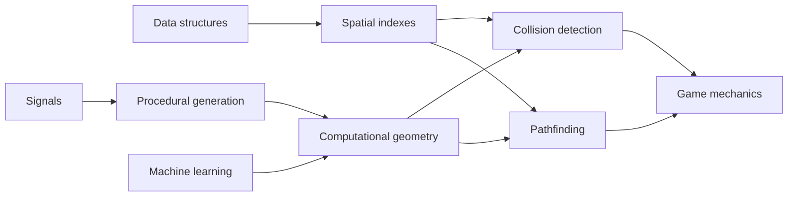

# reynard-algorithms

Algorithms and data structures for spatial computing: collision detection, pathfinding, computational geometry, procedural generation, signal processing and the small data structures those systems need. Each implementation is plain TypeScript with no runtime dependencies, a documented asymptotic bound, and a guide that states the mathematics it rests on.

## Install

```bash
pnpm add @entropy-tamer/reynard-algorithms
```

## What the package covers

| Area | Representative implementations |
| --- | --- |
| Data structures | Union-Find, Bloom filter, priority queue, LRU cache, trie, Fenwick tree, interval tree, segment tree |
| Spatial indexes | spatial hash, quadtree, k-d tree, octree, BVH, R-tree |
| Collision | sweep and prune, AABB, OBB, SAT, spatial collision optimizer |
| Geometry | line rasterization, convex hull, Delaunay, Voronoi, clipping, splines, triangulation |
| Pathfinding | A*, JPS, Theta*, flow field, HPA*, visibility graph, shadowcasting |
| Procedural generation | simplex and Perlin noise, cellular automata, Poisson disk, WFC, space colonization, StructureForge |
| Machine learning | PCA, MDS, Isomap, k-means, decision trees, Markov chains, NEAT, Q-learning |
| Signals and rendering | FFT, DCT, DST, fog, frustum culling, volumetric marching |
| Game mechanics | steering behaviors, inverse kinematics, constraint solvers, navmesh |

The full catalog, with per-implementation links, is in [`docs/CATALOGUE.md`](docs/CATALOGUE.md). The same catalog is rendered at [sly.so/reynard#algorithms](https://sly.so/reynard#algorithms).

## Quick start

Union-Find answers connectivity questions in near-constant amortized time:

```typescript
import { UnionFind } from "@entropy-tamer/reynard-algorithms";

const uf = new UnionFind(10);
uf.union(0, 1);
uf.union(1, 2);
uf.union(3, 4);

uf.connected(0, 2); // true
uf.connected(0, 3); // false
```

A* searches with the evaluation function

$$
f(n) = g(n) + h(n),
$$

where $g$ is the cost so far and $h$ estimates the remaining cost. The heuristic must never overestimate for the path to be optimal:

```typescript
import { AStar, manhattanDistance } from "@entropy-tamer/reynard-algorithms";

const astar = new AStar({
  heuristic: manhattanDistance,
  config: { allowDiagonal: false },
});

const grid = {
  width: 4,
  height: 3,
  cellSize: 1,
  cells: [
    [true, true, true, false],
    [true, false, true, true],
    [true, true, true, true],
  ],
};

const result = astar.findPath({ x: 0, y: 0 }, { x: 3, y: 2 }, grid);
if (result.success) {
  console.log(result.path, result.totalCost);
}
```

Procedural noise samples a continuous field from an integer seed:

```typescript
import { SimplexNoise } from "@entropy-tamer/reynard-algorithms";

const noise = new SimplexNoise({ seed: 42, frequency: 0.01, octaves: 4 });
const height = noise.noise2D(100, 200);
```

## How the pieces fit



The dependency arrow is the useful one: a collision pass uses a spatial index, a navmesh uses a triangulation, and a flow field uses the same grid the pathfinder walks. The package keeps the layers separate so a caller can take the index without the game loop.

## Optimization and measurement

`detectCollisions` chooses a broad phase from the input size and then runs the narrow phase on the candidate pairs. The threshold is configurable:

```typescript
import { configureOptimization, detectCollisions } from "@entropy-tamer/reynard-algorithms";

await configureOptimization({ spatialHashCellSize: 64, hybridThreshold: 64 });
const pairs = detectCollisions(boxes);
```

`PerformanceBenchmark`, `PerformanceTimer` and `FrameRateMonitor` measure the outcome. Every algorithm also exposes statistics for the work it did, so a caller can compare the predicted bound with the observed count.

## Documentation

- [`docs/CATALOGUE.md`](docs/CATALOGUE.md): every implementation with its guide link.
- [`docs/algorithms/INDEX.md`](docs/algorithms/INDEX.md): the guide index.
- [docs/guides/](docs/guides/): the shared foundations (geometry, memoization, memory pooling, performance, profiling, configuration).
- [sly.so/reynard#algorithms](https://sly.so/reynard#algorithms): the same catalog as a page.

Each guide states the model, the equations, the asymptotic cost and the failure
modes that the implementation guards against. Start with the guide for the area,
then read the source; the source names the guide in its module header.

## Development

```bash
pnpm typecheck       # tsc, no emit
pnpm test            # vitest, excluding the performance suites
pnpm test:perf       # the performance suites
pnpm lint            # biome
pnpm bench           # the unified benchmark runner
pnpm examples        # run the usage examples
```

`pnpm build` produces the ESM bundle, the CJS bundle and the declaration files. The package has no runtime dependencies.

## License

MIT. See [LICENSE](LICENSE).
