# reynard-algorithms

A library of algorithms and data structures for spatial computing, collision detection, pathfinding, and procedural generation.

## What This Library Does

This library provides implementations of algorithms and data structures for solving computational geometry problems, detecting collisions between objects, finding paths through spaces, generating procedural content, and processing signals. It includes the PAW optimization framework that automatically selects algorithms based on workload characteristics and performance metrics.

The algorithms are designed for practical use in game development, simulation, graphics programming, and other domains that require efficient geometric computations.

## Table of Contents

- [reynard-algorithms](#reynard-algorithms)
  - [What This Library Does](#what-this-library-does)
  - [Table of Contents](#table-of-contents)
  - [Installation](#installation)
  - [Architecture Overview](#architecture-overview)
  - [Core Concepts](#core-concepts)
    - [Data Structures](#data-structures)
      - [Union-Find (Disjoint Set Union)](#union-find-disjoint-set-union)
      - [Bloom Filter](#bloom-filter)
      - [Priority Queue](#priority-queue)
      - [LRU Cache](#lru-cache)
      - [Fenwick Tree (Binary Indexed Tree)](#fenwick-tree-binary-indexed-tree)
      - [Interval Tree](#interval-tree)
      - [Segment Tree](#segment-tree)
      - [Trie (Prefix Tree)](#trie-prefix-tree)
    - [Spatial Structures](#spatial-structures)
      - [Spatial Hash](#spatial-hash)
      - [Quadtree](#quadtree)
      - [K-d Tree](#k-d-tree)
      - [Octree](#octree)
      - [BVH (Bounding Volume Hierarchy)](#bvh-bounding-volume-hierarchy)
      - [R-Tree](#r-tree)
    - [Computational Geometry](#computational-geometry)
      - [Bresenham's Line Algorithm](#bresenhams-line-algorithm)
      - [DDA Line Algorithm](#dda-line-algorithm)
      - [Supercover Line Algorithm](#supercover-line-algorithm)
      - [Delaunay Triangulation](#delaunay-triangulation)
      - [Convex Hull](#convex-hull)
      - [Marching Squares](#marching-squares)
      - [Simplex Noise](#simplex-noise)
      - [Poisson Disk Sampling](#poisson-disk-sampling)
      - [Wave Function Collapse](#wave-function-collapse)
      - [StructureForge](#structureforge)
      - [Voronoi Diagram](#voronoi-diagram)
      - [Polygon Clipping](#polygon-clipping)
      - [Polygon Simplification](#polygon-simplification)
      - [Polygon Boolean Operations](#polygon-boolean-operations)
      - [Circular Positioning](#circular-positioning)
      - [Line Segment Intersection (Bentley-Ottmann)](#line-segment-intersection-bentley-ottmann)
      - [Minimum Bounding Box](#minimum-bounding-box)
      - [Splines (Bezier Curves)](#splines-bezier-curves)
      - [Catmull-Rom Splines](#catmull-rom-splines)
      - [B-Splines](#b-splines)
      - [NURBS](#nurbs)
      - [Hermite Splines](#hermite-splines)
      - [Ear Clipping Triangulation](#ear-clipping-triangulation)
    - [Collision Detection (Extended)](#collision-detection-extended)
      - [OBB (Oriented Bounding Box)](#obb-oriented-bounding-box)
      - [AABB (Axis-Aligned Bounding Box)](#aabb-axis-aligned-bounding-box)
      - [SAT (Separating Axis Theorem)](#sat-separating-axis-theorem)
      - [Sweep and Prune](#sweep-and-prune)
      - [Spatial Collision Optimizer](#spatial-collision-optimizer)
    - [Pathfinding](#pathfinding)
      - [A\* (A-Star)](#a-a-star)
      - [JPS (Jump Point Search)](#jps-jump-point-search)
      - [Theta\* (Theta-Star)](#theta-theta-star)
      - [Flow Field](#flow-field)
      - [HPA\* (Hierarchical Pathfinding A\*)](#hpa-hierarchical-pathfinding-a)
    - [Game Mechanics](#game-mechanics)
      - [Steering Behaviors](#steering-behaviors)
      - [Inverse Kinematics](#inverse-kinematics)
      - [Constraint Solvers](#constraint-solvers)
      - [Navmesh](#navmesh)
    - [Machine Learning (Extended)](#machine-learning-extended)
      - [K-Means Clustering](#k-means-clustering)
      - [Decision Trees](#decision-trees)
      - [Markov Chains](#markov-chains)
      - [Behavior Trees](#behavior-trees)
      - [NEAT (NeuroEvolution of Augmenting Topologies)](#neat-neuroevolution-of-augmenting-topologies)
      - [Reinforcement Learning](#reinforcement-learning)
    - [Procedural Generation (Extended)](#procedural-generation-extended)
      - [Cellular Automata](#cellular-automata)
    - [Graph Layout](#graph-layout)
      - [Force Directed Graph Layout](#force-directed-graph-layout)
    - [Pathfinding (Extended)](#pathfinding-extended)
      - [Visibility Graph](#visibility-graph)
      - [Visibility (Shadowcasting FOV)](#visibility-shadowcasting-fov)
    - [Machine Learning](#machine-learning)
      - [PCA (Principal Component Analysis)](#pca-principal-component-analysis)
      - [Isomap](#isomap)
      - [MDS (Multidimensional Scaling)](#mds-multidimensional-scaling)
    - [Signal Processing](#signal-processing)
      - [FFT (Fast Fourier Transform)](#fft-fast-fourier-transform)
      - [DCT (Discrete Cosine Transform)](#dct-discrete-cosine-transform)
      - [DST (Discrete Sine Transform)](#dst-discrete-sine-transform)
    - [Rendering](#rendering)
      - [Frustum Culling](#frustum-culling)
    - [Sorting](#sorting)
      - [Sorting Algorithms](#sorting-algorithms)
    - [PAW Optimization Framework](#paw-optimization-framework)
      - [Algorithm Selectors](#algorithm-selectors)
      - [Memory Pooling](#memory-pooling)
      - [Performance Caching](#performance-caching)
      - [Workload Analysis](#workload-analysis)
  - [Quick Start](#quick-start)
    - [Using Union-Find](#using-union-find)
    - [Using A\* Pathfinding](#using-a-pathfinding)
    - [Using Simplex Noise](#using-simplex-noise)
    - [Using Delaunay Triangulation](#using-delaunay-triangulation)
  - [Performance Optimizations](#performance-optimizations)
    - [Performance - Memory Pooling](#performance---memory-pooling)
    - [Result Caching](#result-caching)
    - [Algorithm Selection](#algorithm-selection)
  - [API Reference](#api-reference)
    - [API Reference - Data Structures](#api-reference---data-structures)
      - [UnionFind](#unionfind)
      - [BloomFilter](#bloomfilter)
      - [PriorityQueue](#priorityqueue)
    - [API Reference - Pathfinding](#api-reference---pathfinding)
      - [AStar](#astar)
    - [Procedural Generation](#procedural-generation)
      - [SimplexNoise](#simplexnoise)
    - [API Reference - Computational Geometry](#api-reference---computational-geometry)
      - [DelaunayTriangulation](#delaunaytriangulation)
      - [ConvexHull](#convexhull)
    - [API Reference - Signal Processing](#api-reference---signal-processing)
      - [FFT](#fft)
    - [PAW Framework](#paw-framework)
      - [AlgorithmSelector](#algorithmselector)
      - [MemoryPool](#memorypool)
      - [PerformanceCache](#performancecache)

## Installation

```bash
pnpm add @entropy-tamer/reynard-algorithms
```

## Architecture Overview

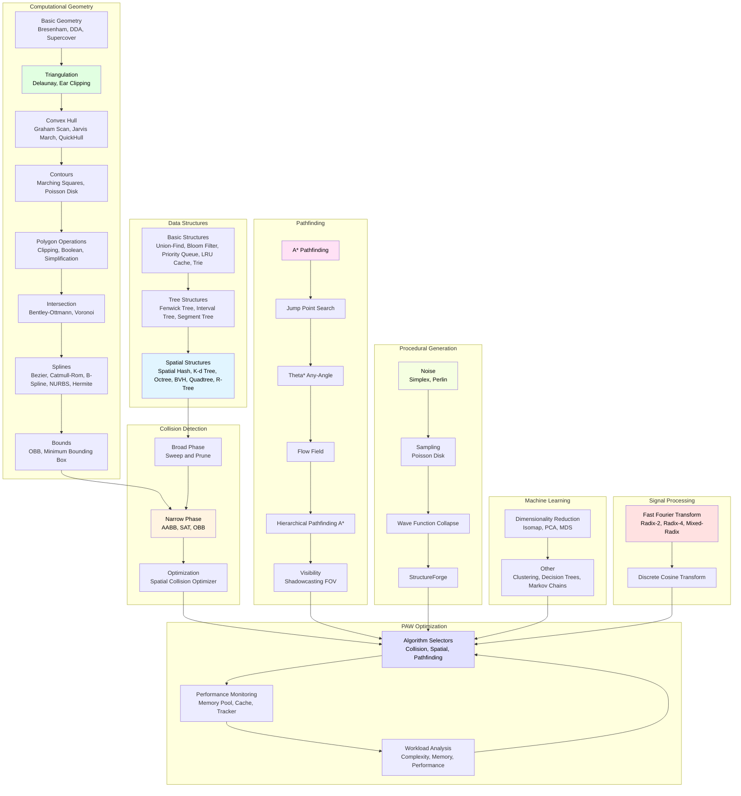

## Core Concepts

### Data Structures

#### Union-Find (Disjoint Set Union)

Union-Find is a data structure that tracks a partition of elements into disjoint sets. It supports two operations: finding which set an element belongs to, and merging two sets. The implementation uses path compression and union by rank to achieve near-constant amortized time complexity.

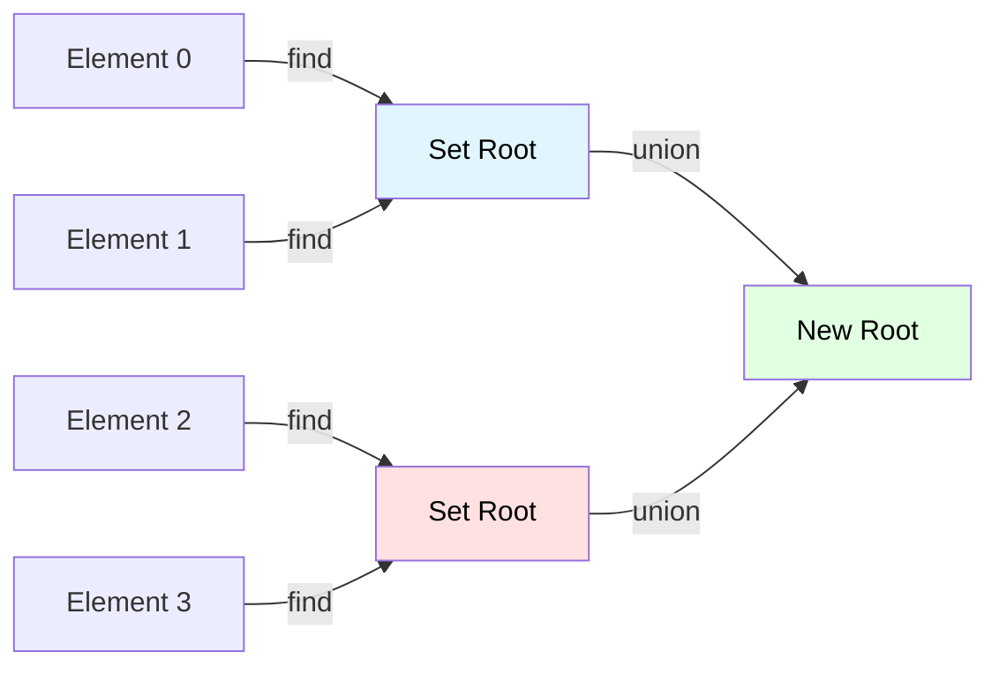

The key operations are:

- `find(x)`: Returns the representative (root) of the set containing element x
- `union(x, y)`: Merges the sets containing elements x and y
- `connected(x, y)`: Returns true if x and y are in the same set

Path compression flattens the tree structure during find operations, making future queries faster. Union by rank attaches the shallower tree under the deeper tree, keeping the tree balanced. Together, these optimizations give an amortized time complexity of O(α(n)), where α is the inverse Ackermann function, which grows so slowly it's effectively constant for all practical input sizes.

#### Bloom Filter

A Bloom filter is a probabilistic data structure that tests whether an element is a member of a set. It can return false positives (claiming an element is in the set when it's not) but never false negatives. It uses multiple hash functions and a bit array to achieve space-efficient membership testing.

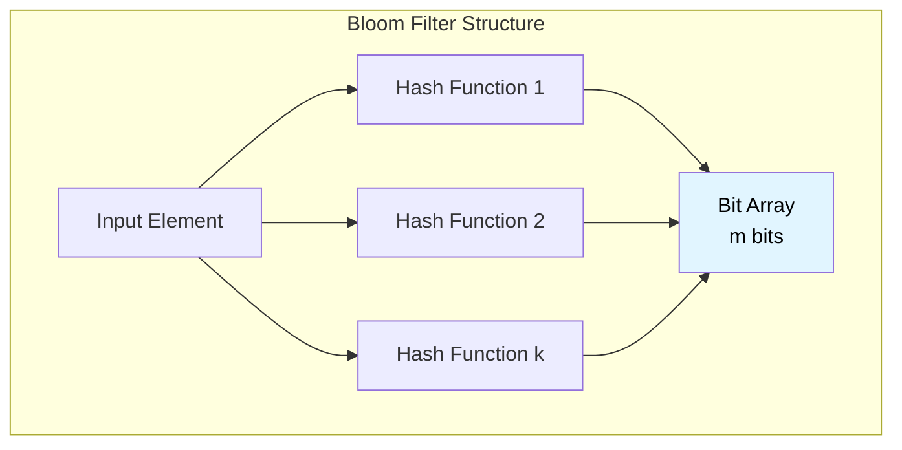

The probability of a false positive depends on the number of hash functions k, the size of the bit array m, and the number of inserted elements n:

$$ P_{fp} \approx \left(1 - e^{-kn/m}\right)^k $$

For a given expected number of elements n and desired false positive rate p, the optimal bit array size and number of hash functions are:

$$ m = -\frac{n \ln p}{(\ln 2)^2} $$
$$ k = \frac{m}{n} \ln 2 $$

Bloom filters are useful when you need fast membership testing with limited memory and can tolerate occasional false positives, such as in web caches, spell checkers, or database query optimization.

#### Priority Queue

A priority queue is a data structure that supports inserting elements and extracting the element with the highest (or lowest) priority. This implementation uses a binary heap, which provides O(log n) time for insertion and extraction operations.

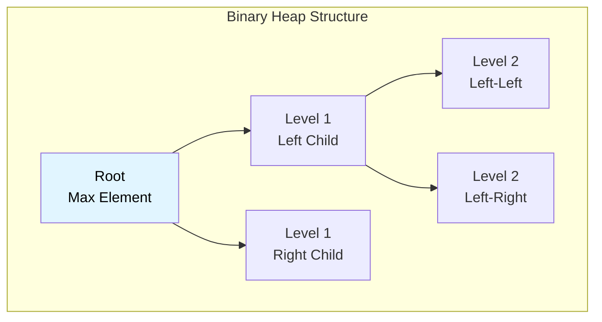

The heap property ensures that each parent node is greater than or equal to its children (for a max-heap). When inserting, the element is added at the end and bubbled up to restore the heap property. When extracting, the root is removed and the last element is moved to the root, then bubbled down.

Time complexity:

- Insert: O(log n)
- Extract max/min: O(log n)
- Peek: O(1)
- Build heap from array: O(n)

Priority queues are used in Dijkstra's algorithm, A* pathfinding, Huffman coding, and many other algorithms where you need to repeatedly access the highest-priority element.

#### LRU Cache

A Least Recently Used (LRU) cache evicts the least recently used item when the cache reaches capacity. This implementation uses a hash map combined with a doubly-linked list to achieve O(1) time for both get and set operations.

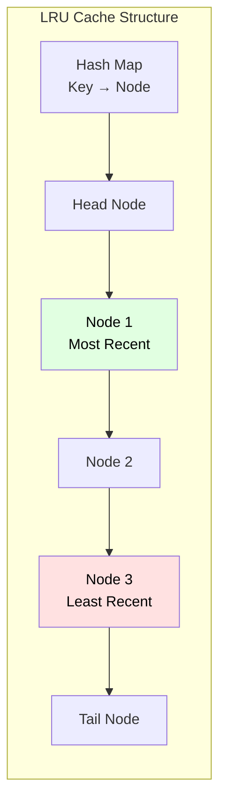

When an item is accessed, it's moved to the front of the list (most recently used). When a new item is added and the cache is full, the item at the back of the list (least recently used) is evicted. The hash map provides O(1) access to nodes in the linked list.

LRU caches are used for caching database queries, API responses, web pages, and any scenario where you want to keep recently-used items accessible while limiting memory usage.

#### Fenwick Tree (Binary Indexed Tree)

A Fenwick tree is a data structure that efficiently computes prefix sums and allows point updates. It achieves O(log n) time for both operations while using O(n) space.

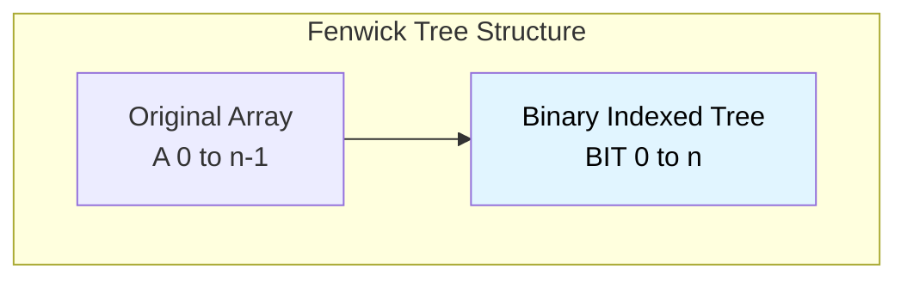

The key insight is that each index i in the BIT stores the sum of a range of elements in the original array. Specifically, index i stores the sum of elements from (i - LSB(i) + 1) to i, where LSB(i) is the least significant bit of i.

To compute the prefix sum from index 0 to i, you sum the values at indices i, i - LSB(i), i - LSB(i) - LSB(i - LSB(i)), and so on, until you reach 0. To update a single element, you add the delta to index i, then to i + LSB(i), i + LSB(i) + LSB(i + LSB(i)), and so on.

Fenwick trees are used for frequency counting, range sum queries, and inversion counting. They're simpler to implement than segment trees and faster for point updates and prefix sum queries.

#### Interval Tree

An interval tree stores intervals and supports efficient queries for all intervals that overlap a given point or interval. This implementation uses a balanced binary search tree where each node stores the maximum endpoint of intervals in its subtree.

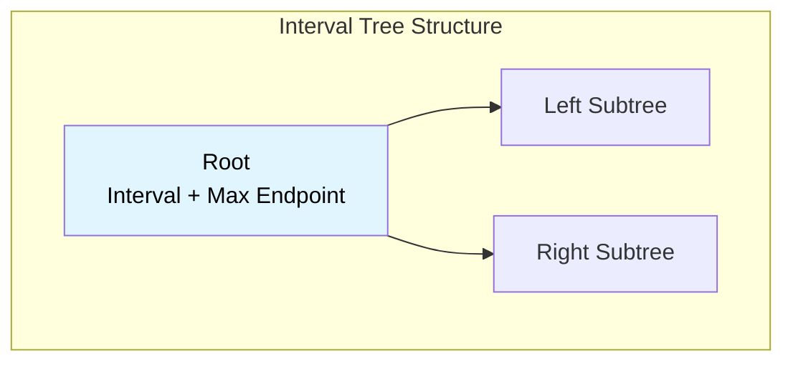

To find all intervals overlapping a query point, you start at the root and recursively traverse the tree. If the query point is less than the node's interval start, you search the left subtree. If it's greater, you search the right subtree. You also check the node's interval and the subtree with the maximum endpoint that could overlap the query.

Time complexity:

- Insert: O(log n)
- Query: O(log n + k), where k is the number of overlapping intervals
- Delete: O(log n)

Interval trees are used in scheduling, computational geometry, and database queries involving ranges.

#### Segment Tree

A segment tree is a binary tree data structure used for storing information about intervals or segments. It allows efficient range queries and point updates in O(log n) time.

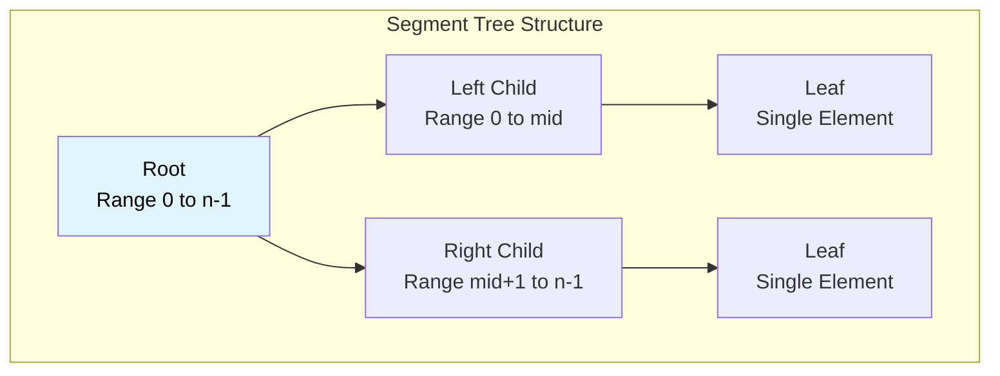

Each node in the segment tree represents an interval of the array. The root represents the entire array, and each leaf represents a single element. Internal nodes store aggregated information about their interval (sum, minimum, maximum, etc.).

To query a range, you traverse the tree, combining results from nodes that are fully contained in the query range. To update a single element, you update the corresponding leaf and propagate the change up to the root.

Segment trees are used for range minimum queries, range sum queries, lazy propagation for range updates, and many other range-based operations.

#### Trie (Prefix Tree)

A trie is a tree-like data structure used to store strings where each node represents a character. All descendants of a node share a common prefix, making tries efficient for prefix-based searches.

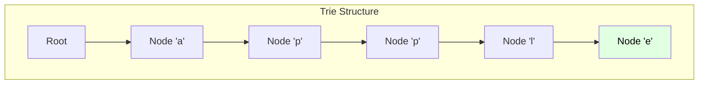

To insert a word, you traverse the trie, creating nodes for characters that don't exist. To search for a word, you traverse following the characters, returning true if you reach a node marked as the end of a word. To search for a prefix, you traverse following the characters, returning true if the path exists regardless of whether it ends at a word boundary.

Time complexity:

- Insert: O(m), where m is the word length
- Search: O(m)
- Prefix search: O(m)

Tries are used for autocomplete systems, spell checkers, IP routing tables, and implementing dictionaries with prefix operations.

### Spatial Structures

#### Spatial Hash

Spatial hashing divides space into a uniform grid of cells. Each cell stores references to objects that intersect that cell. This provides O(1) average-case lookup for nearby objects when objects are evenly distributed.

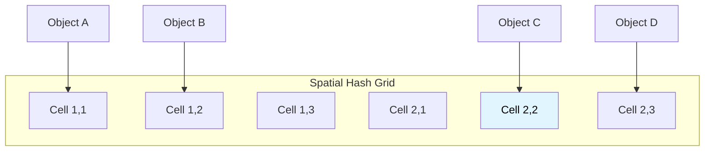

The cell size should be chosen based on the typical object size. If cells are too small, objects span many cells and queries check many cells. If cells are too large, each cell contains many objects and queries are slow.

Time complexity:

- Insert: O(1) average
- Query nearby objects: O(k) where k is the number of cells the query region intersects
- Remove: O(1) average

Spatial hashing is simple to implement and works well for uniformly distributed objects. It's used in collision detection broad-phase, spatial queries in games, and particle systems.

#### Quadtree

A quadtree recursively subdivides 2D space into four quadrants. Each node represents a rectangular region and stores objects that intersect that region. When a node contains too many objects, it splits into four children.

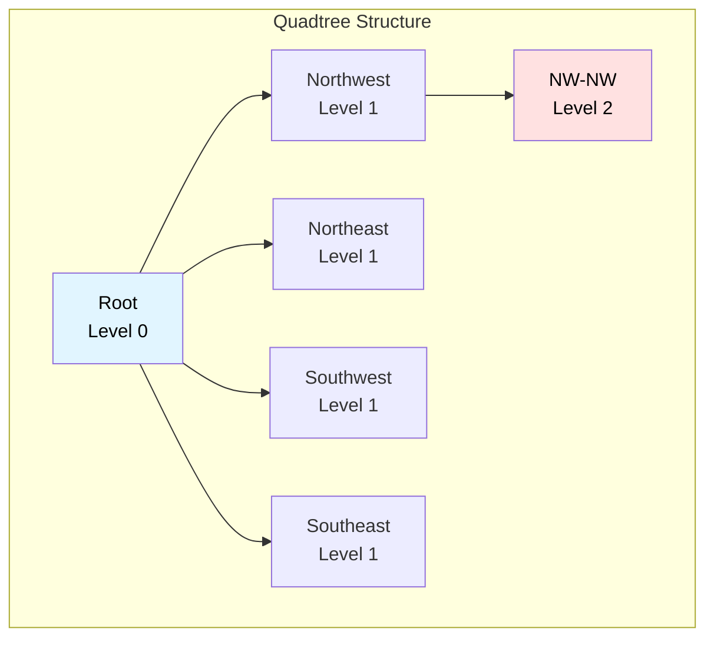

The subdivision continues until a maximum depth is reached or a node contains fewer than a threshold number of objects. This adapts to non-uniform object distributions, creating finer subdivisions in dense areas and coarser subdivisions in sparse areas.

Time complexity:

- Insert: O(log n) average for balanced trees
- Query: O(log n + k) where k is the number of results
- Remove: O(log n) average

Quadtrees are used for spatial indexing in games, image compression, and geographic information systems. They're particularly effective when objects are clustered non-uniformly.

#### K-d Tree

A K-d tree is a binary tree that partitions k-dimensional space. At each level, the tree splits along one dimension, cycling through dimensions at each level. For 2D, it alternates between splitting on x and y coordinates.

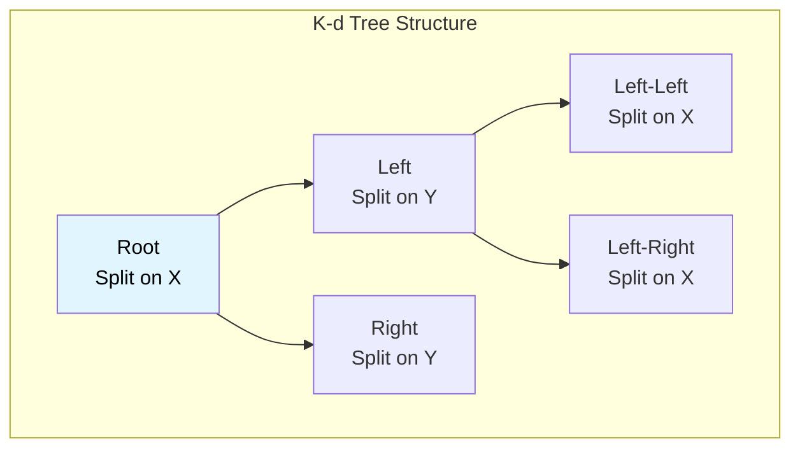

The splitting point is typically chosen as the median of the points in that dimension along the current axis, which creates a balanced tree. This makes K-d trees effective for nearest neighbor searches and range queries.

Time complexity:

- Build: O(n log n) for balanced tree
- Nearest neighbor: O(log n) average
- Range query: O(n^(1-1/k) + k) where k is the number of results

K-d trees are used for nearest neighbor searches, ray tracing acceleration, and spatial indexing in low-dimensional spaces. They become less effective in high dimensions due to the curse of dimensionality.

#### Octree

An octree extends the quadtree concept to 3D space, recursively subdividing into eight octants. Each node represents a cubic region and stores objects that intersect that region.

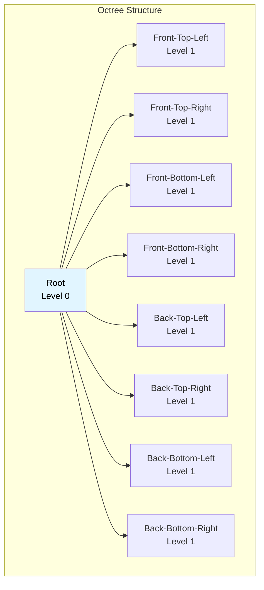

Octrees are used in 3D graphics for visibility culling, collision detection, and level of detail management. They're also used in voxel-based games and 3D spatial indexing.

Time complexity:

- Insert: O(log n) average
- Query: O(log n + k)
- Ray intersection: O(log n) average for balanced trees

#### BVH (Bounding Volume Hierarchy)

A BVH organizes geometric primitives in a tree where each node stores a bounding volume that encloses all primitives in its subtree. This accelerates ray tracing and collision detection by allowing early rejection of entire subtrees.

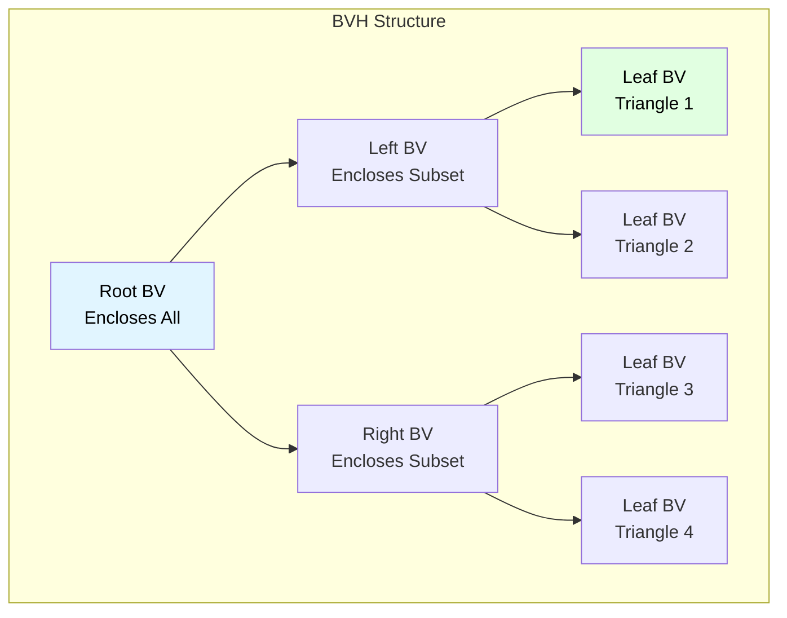

The tree is typically built using surface area heuristic (SAH), which chooses splits that minimize the expected cost of ray traversal. A good BVH is balanced and has small, tight bounding volumes at each level.

Time complexity:

- Build: O(n log n) with SAH
- Ray intersection: O(log n) average
- Frustum culling: O(log n) average

BVHs are essential for real-time ray tracing, collision detection in physics engines, and visibility determination in rendering.

#### R-Tree

An R-tree is a tree data structure designed for spatial access methods, similar to B-trees but for multi-dimensional data. Each node stores minimum bounding rectangles that enclose its children.

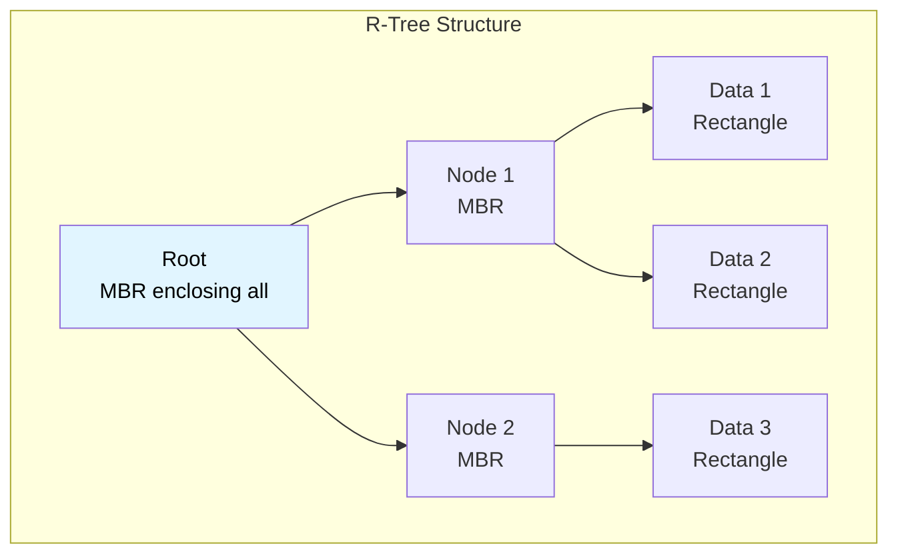

R-trees are optimized for disk storage and I/O, making them suitable for databases. The R*-tree variant uses more sophisticated insertion and deletion algorithms to maintain better tree quality.

Time complexity:

- Search: O(log n) average
- Insert: O(log n) average
- Delete: O(log n) average

R-trees are used in spatial databases, geographic information systems, and indexing multi-dimensional data.

### Computational Geometry

#### Bresenham's Line Algorithm

Bresenham's line algorithm draws lines on a raster grid using only integer arithmetic. It chooses which pixels to illuminate to approximate a straight line between two points, minimizing error accumulation.

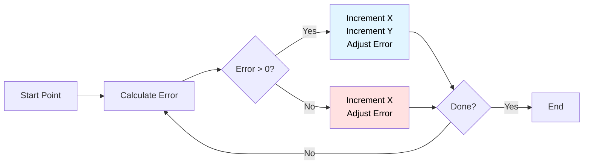

The algorithm maintains an error term that tracks how far the current pixel is from the ideal line. At each step, it decides whether to move in the x-direction only, or in both x and y directions, based on whether the error exceeds half a pixel.

The decision parameter is updated incrementally:
$$ d_{new} = d_{old} + 2\Delta y - 2\Delta x $$
when stepping diagonally, and:
$$ d_{new} = d_{old} + 2\Delta y $$
when stepping horizontally.

Bresenham's algorithm is used in computer graphics for line drawing, rasterization, and pixel-based rendering. It's fast because it uses only integer addition and subtraction.

#### DDA Line Algorithm

The Digital Differential Analyzer (DDA) algorithm is a line drawing algorithm that uses floating-point arithmetic to calculate pixel positions. It's simpler to implement than Bresenham but slower due to floating-point operations.

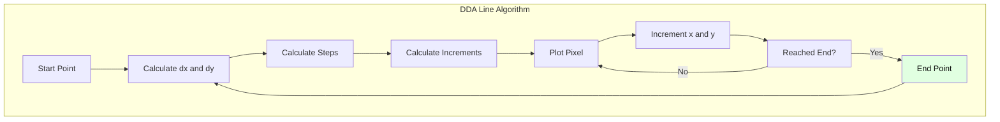

The algorithm calculates the number of steps as the maximum of the absolute differences in x and y. It then calculates the increment for each coordinate:

$$ x_{inc} = \frac{dx}{steps}, \quad y_{inc} = \frac{dy}{steps} $$

At each step, it plots the current pixel and increments both coordinates by their respective increments.

Time complexity: O(max(|dx|, |dy|))

DDA is used in simple line drawing implementations and educational contexts due to its straightforward implementation.

#### Supercover Line Algorithm

Supercover line drawing ensures that every grid cell intersected by the line is marked, not just the pixels whose centers are closest to the line. This is important for grid-based algorithms and voxel traversal.

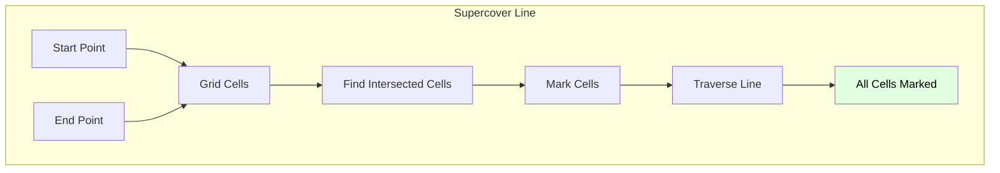

The algorithm uses a modified Bresenham approach that considers when the line exactly crosses grid boundaries. It ensures that all cells the line passes through are included, which is critical for:

- Ray casting in voxel worlds
- Grid-based collision detection
- Line of sight calculations

Supercover is used in game engines for voxel traversal, ray marching, and grid-based pathfinding.

#### Delaunay Triangulation

Delaunay triangulation creates a triangulation of a set of points such that no point lies inside the circumcircle of any triangle. This property maximizes the minimum angle of all triangles, avoiding thin, sliver triangles.

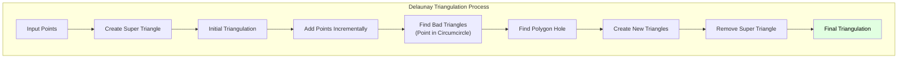

The Bowyer-Watson algorithm incrementally adds points to the triangulation. For each point, it finds all triangles whose circumcircles contain the point (bad triangles), removes them, and creates new triangles connecting the point to the boundary of the resulting polygonal hole.

The circumcircle of a triangle with vertices (x₁, y₁), (x₂, y₂), (x₃, y₃) has center:
$$ x_c = \frac{D_x}{D}, \quad y_c = \frac{D_y}{D} $$
where D is the determinant of the matrix formed by the coordinates.

Delaunay triangulations are used in mesh generation, terrain modeling, and finite element analysis. The dual graph of a Delaunay triangulation is the Voronoi diagram.

#### Convex Hull

The convex hull of a set of points is the smallest convex polygon that contains all points. Multiple algorithms are implemented, each with different performance characteristics.

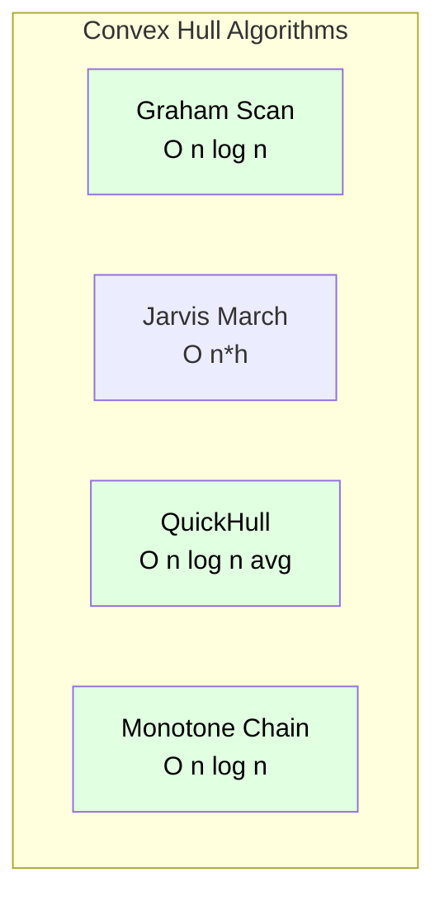

Graham Scan sorts points by polar angle from the bottom-most point, then builds the hull by iteratively adding points and removing the last point if it creates a clockwise turn. This is detected using the cross product:
$$ \text{cross}(O, A, B) = (A_x - O_x)(B_y - O_y) - (A_y - O_y)(B_x - O_x) $$

Jarvis March (gift wrapping) starts with the leftmost point and repeatedly finds the point that makes the smallest right turn, wrapping around the hull. Its complexity is O(nh) where h is the number of hull points.

QuickHull recursively finds the furthest point from the line between the leftmost and rightmost points, dividing the point set and recursively processing each side.

Convex hulls are used in collision detection, shape analysis, and computational geometry problems.

#### Marching Squares

Marching squares extracts contour lines from a scalar field on a grid. For each cell, it examines the values at the four corners and determines which edges the contour crosses based on a lookup table.

```mermaid
flowchart TB
    subgraph "Marching Squares Cell"
        TL[Top Left]
        TR[Top Right]
        BL[Bottom Left]
        BR[Bottom Right]
        Center[Contour Lines]
    end

    TL --> Center
    TR --> Center
    BL --> Center
    BR --> Center

    style Center fill:#e1f5ff,color:#000
```

Each cell has 2⁴ = 16 possible configurations based on which corners are above or below the threshold. The algorithm uses a lookup table to determine how to draw the contour lines through each cell.

Marching squares is used for terrain contour generation, medical imaging (MRI/CT scans), and isosurface extraction in scientific visualization.

#### Simplex Noise

Simplex noise is a gradient noise algorithm that improves upon Perlin noise by using a simplex grid instead of a hypercube grid. This reduces computational complexity and avoids directional artifacts.

```mermaid
flowchart TB
    subgraph "Simplex Noise Lattice"
        P1[Point 1]
        P2[Point 2]
        P3[Point 3]
        P4[Point 4]
        Query[Query Point]
        Grad[Gradient Vectors]
        Noise[Noise Value]
    end

    Query --> P1
    Query --> P2
    Query --> P3
    Query --> P4
    P1 --> Grad
    P2 --> Grad
    P3 --> Grad
    P4 --> Grad
    Grad --> Noise

    style Noise fill:#e1ffe1,color:#000
```

The algorithm first determines which simplex the query point falls in, then computes contribution from each corner of that simplex based on the distance to the corner and the gradient vector at that corner. The contributions are smoothed using a fade function to ensure continuity.

Fractal (octave) noise combines multiple noise layers at different frequencies and amplitudes:
$$ \text{noise}(x) = \sum_{i=0}^{n-1} \text{amplitude}_i \cdot \text{noise}(\text{frequency}_i \cdot x) $$

Simplex noise is used for procedural terrain generation, texture synthesis, and organic-looking patterns in games and graphics.

#### Poisson Disk Sampling

Poisson disk sampling generates points that are randomly distributed but maintain a minimum distance from each other, creating a "blue noise" pattern without clustering.

```mermaid
flowchart TB
    subgraph "Poisson Disk Sampling"
        Grid[Background Grid]
        Active[Active List]
        P1[Point 1]
        P2[Point 2]
        P3[Point 3]
        Rejected[Rejected Points]
    end

    Active --> P1
    Active --> P2
    Active --> P3
    P1 --> Rejected
    P2 --> Rejected
    P3 --> Rejected

    style Active fill:#e1f5ff,color:#000
    style Rejected fill:#ffe1e1,color:#000
```

The algorithm maintains a grid to accelerate distance queries and a list of active points from which new candidates are generated. For each active point, it generates k random candidates in an annulus around the point. A candidate is accepted only if it's at least distance r from all existing points.

The minimum distance r controls the density of points. The relationship between r, the number of points n, and the area A is approximately:
$$ n \approx \frac{A}{\pi r^2} $$

Poisson disk sampling is used for antialiasing, object placement in games, and creating aesthetically pleasing point distributions.

#### Wave Function Collapse

Wave Function Collapse is a constraint-based procedural generation algorithm inspired by quantum mechanics. It maintains a set of possible states for each cell and collapses cells one by one based on constraints.

```mermaid
flowchart TB
    subgraph "Wave Function Collapse"
        Grid[Grid of Cells]
        Entropy[Cell with Minimum Entropy]
        Collapse[Collapse to Single State]
        Propagate[Propagate Constraints]
        Converged[All Cells Collapsed?]
        Contradiction[Contradiction?]
        Backtrack[Backtrack and Retry]
        Result[Final Pattern]
    end

    Grid --> Entropy
    Entropy --> Collapse
    Collapse --> Propagate
    Propagate --> Converged
    Converged -->|No| Entropy
    Converged -->|Yes| Result
    Propagate --> Contradiction
    Contradiction -->|Yes| Backtrack
    Backtrack --> Entropy

    style Result fill:#e1ffe1,color:#000
    style Contradiction fill:#ffe1e1,color:#000
```

Each cell starts with a set of possible tiles/states. The algorithm chooses the cell with the fewest possibilities (minimum entropy), randomly selects one of its states, and propagates constraints to neighboring cells, removing incompatible states. If a contradiction occurs (a cell has no possible states), it backtracks.

The entropy of a cell is:
$$ H = -\sum_{i} p_i \log p_i $$
where p_i is the probability of state i.

Wave Function Collapse is used for procedural map generation, texture synthesis, and creating consistent patterns from example images.

#### StructureForge

StructureForge generates procedural buildings, dungeons, and other structures using constraint-based rules and pattern matching. It creates coherent architectural layouts by combining predefined building blocks with spatial constraints.

```mermaid
flowchart TB
    subgraph "StructureForge"
        Config[Structure Config]
        Pattern[Pattern Library]
        Constraints[Spatial Constraints]
        Generate[Generate Layout]
        Validate[Validate Constraints]
        Refine[Refine Details]
        Output[Final Structure]
    end

    Config --> Generate
    Pattern --> Generate
    Constraints --> Validate
    Generate --> Validate
    Validate -->|Pass| Refine
    Validate -->|Fail| Generate
    Refine --> Output

    style Output fill:#e1ffe1,color:#000
```

The algorithm uses a constraint satisfaction approach:

1. Select building type (tower, dungeon, building)
2. Apply architectural rules (room sizes, connectivity, symmetry)
3. Place structural elements (walls, doors, windows)
4. Add decorative details based on style

Structure generation follows hierarchical decomposition:
$$ S = \bigcup_{i} \text{Component}_i \text{ where } \text{Constraints}(\text{Component}_i) = \text{true} $$

StructureForge is used in roguelike games, level generation, and procedural city generation.

#### Voronoi Diagram

A Voronoi diagram partitions space into regions based on distance to a set of seed points. Each region contains all points closer to its seed than to any other seed.

```mermaid
flowchart TB
    subgraph "Voronoi Diagram"
        S1[Seed 1]
        S2[Seed 2]
        S3[Seed 3]
        R1[Region 1]
        R2[Region 2]
        R3[Region 3]
        Edge[Voronoi Edge]
    end

    S1 --> R1
    S2 --> R2
    S3 --> R3
    R1 --> Edge
    R2 --> Edge
    R3 --> Edge

    style Edge fill:#e1f5ff,color:#000
```

Voronoi diagrams are the dual of Delaunay triangulations: each Voronoi edge is perpendicular to a Delaunay edge, and each Voronoi vertex is the circumcenter of a Delaunay triangle.

The distance from a point p to a seed s is typically Euclidean:
$$ d(p, s) = \sqrt{(p_x - s_x)^2 + (p_y - s_y)^2} $$

Voronoi diagrams are used in nearest neighbor queries, facility location problems, and cellular biology to model cell growth.

#### Polygon Clipping

Polygon clipping computes the intersection, union, or difference of two polygons. The Sutherland-Hodgman algorithm clips a polygon against a convex clipping polygon, while Weiler-Atherton handles arbitrary (possibly concave) polygons.

```mermaid
flowchart TB
    subgraph "Polygon Clipping"
        Subject[Subject Polygon]
        Clip[Clip Polygon]
        Intersect[Intersection]
        Union[Union]
        Diff[Difference]
        Result[Clipped Polygon]
    end

    Subject --> Intersect
    Clip --> Intersect
    Subject --> Union
    Clip --> Union
    Subject --> Diff
    Clip --> Diff
    Intersect --> Result
    Union --> Result
    Diff --> Result

    style Result fill:#e1ffe1,color:#000
```

Sutherland-Hodgman clips the subject polygon against each edge of the clipping polygon in sequence, maintaining a list of vertices that are inside the clipping region. For each edge, it determines which vertices are inside/outside and computes intersection points where edges cross.

Weiler-Atherton handles concave polygons by tracking the entry and exit points of the polygon through the clipping boundary and walking around the boundaries to construct the result.

Polygon clipping is used in computer graphics for window clipping, GIS for overlay operations, and CAD for Boolean operations on shapes.

#### Polygon Simplification

Polygon simplification reduces the number of vertices in a polygon while preserving its essential shape. This is useful for reducing computational complexity, improving rendering performance, and creating level-of-detail representations.

```mermaid
flowchart TB
    subgraph "Polygon Simplification"
        Input[Input Polygon]
        Error[Compute Error]
        Select[Select Vertex to Remove]
        Remove[Remove Vertex]
        Check[Error Below Threshold?]
        Done[Simplified Polygon]
    end

    Input --> Error
    Error --> Select
    Select --> Remove
    Remove --> Check
    Check -->|No| Error
    Check -->|Yes| Done

    style Done fill:#e1ffe1,color:#000
```

The Douglas-Peucker algorithm works by:

1. Finding the point with the maximum distance from the line connecting the endpoints
2. If that distance exceeds the threshold, recursively simplify both halves
3. Otherwise, discard all intermediate points

The perpendicular distance from point P to line AB is:
$$ d = \frac{|(B_y - A_y)P_x - (B_x - A_x)P_y + B_x A_y - B_y A_x|}{\sqrt{(B_y - A_y)^2 + (B_x - A_x)^2}} $$

Time complexity: O(n log n) average, O(n²) worst case for Douglas-Peucker.

Polygon simplification is used in map generalization, mesh reduction, and level-of-detail systems.

#### Polygon Boolean Operations

Polygon boolean operations compute unions, intersections, and differences between polygons. These operations are fundamental for computational geometry, CAD, and GIS applications.

```mermaid
flowchart TB
    subgraph "Polygon Boolean Operations"
        PolyA[Polygon A]
        PolyB[Polygon B]
        Op[Select Operation<br/>Union/Intersection/Difference]
        Decompose[Decompose to Trapezoids]
        Compute[Compute Boolean]
        Reconstruct[Reconstruct Result]
        Result[Final Polygon]
    end

    PolyA --> Op
    PolyB --> Op
    Op --> Decompose
    Decompose --> Compute
    Compute --> Reconstruct
    Reconstruct --> Result

    style Result fill:#e1ffe1,color:#000
```

The Weiler-Atherton algorithm handles boolean operations on polygons by:

1. Finding all intersection points between polygon edges
2. Walking around the polygons following the appropriate rule for the operation
3. Constructing the result polygon from the traversal

For union, vertices inside the other polygon are excluded. For intersection, vertices outside are excluded. For difference, the direction of traversal matters.

Time complexity: O(n + m + k) where n and m are polygon sizes and k is the number of intersections.

Boolean operations are used in CAD for combining shapes, GIS for overlay analysis, and game development for collision region calculation.

#### Circular Positioning

Circular positioning algorithms calculate positions of objects arranged in circular patterns, useful for radial layouts, UI design, and game mechanics.

```mermaid
flowchart TB
    subgraph "Circular Positioning"
        Center[Center Point]
        Radius[Radius]
        Count[Number of Objects]
        Angle[Calculate Angle Step]
        Position[Compute Each Position]
        Layout[Final Layout]
    end

    Center --> Angle
    Radius --> Angle
    Count --> Angle
    Angle --> Position
    Position --> Layout

    style Layout fill:#e1ffe1,color:#000
```

The position of the i-th object in a circle is:
$$ x_i = x_c + r \cdot \cos(\theta_0 + i \cdot \Delta\theta) $$
$$ y_i = y_c + r \cdot \sin(\theta_0 + i \cdot \Delta\theta) $$
where (x_c, y_c) is the center, r is the radius, θ₀ is the starting angle, and Δθ = 2π/n is the angle step.

For concentric circles, the radius can vary:
$$ r_i = r_{base} + i \cdot r_{increment} $$

Circular positioning is used in radial menus, orbital mechanics simulations, and circular UI layouts.

#### Line Segment Intersection (Bentley-Ottmann)

The Bentley-Ottmann algorithm finds all intersection points among a set of line segments efficiently using a sweep line approach. It achieves O((n + k) log n) time where n is the number of segments and k is the number of intersections.

```mermaid
flowchart TB
    subgraph "Bentley-Ottmann Sweep Line"
        Events[Event Queue<br/>Sorted by X]
        Status[Status Structure<br/>Ordered by Y]
        Sweep[Sweep Line]
        Current[Current Event]
        Left[Left Segment]
        Right[Right Segment]
        Intersect[Find Intersections]
        Output[Output Intersections]
    end

    Events --> Current
    Current --> Sweep
    Sweep --> Status
    Status --> Left
    Status --> Right
    Left --> Intersect
    Right --> Intersect
    Intersect --> Output
    Output --> Events

    style Output fill:#e1ffe1,color:#000
```

The algorithm maintains an event queue of segment endpoints and potential intersection points, sorted by x-coordinate. A sweep line moves from left to right, and a status structure maintains the segments currently intersecting the sweep line, ordered by their y-coordinate at the sweep line position.

When the sweep line reaches a left endpoint, the segment is inserted into the status structure. When it reaches a right endpoint, the segment is removed. Intersections are detected when the order of segments in the status structure changes.

Time complexity: O((n + k) log n) where n is the number of segments and k is the number of intersections.

Bentley-Ottmann is used in computational geometry, GIS, and computer graphics for finding all intersections in a set of line segments.

#### Minimum Bounding Box

The minimum bounding box is the smallest-area rectangle that encloses a set of points, with no restriction on orientation. The rotating calipers algorithm finds it in O(n) time after computing the convex hull.

```mermaid
flowchart TB
    subgraph "Minimum Bounding Box"
        Points[Input Points]
        Convex[Compute Convex Hull]
        Edge[Select Edge]
        Caliper[Rotate Caliper]
        Angle[Compute Angle]
        Box[Compute Bounding Box]
        Area[Calculate Area]
        Min[Track Minimum]
        Done[Full Rotation?]
        Result[Minimum Box]
    end

    Points --> Convex
    Convex --> Edge
    Edge --> Caliper
    Caliper --> Angle
    Angle --> Box
    Box --> Area
    Area --> Min
    Min --> Done
    Done -->|No| Edge
    Done -->|Yes| Result

    style Result fill:#e1ffe1,color:#000
```

The algorithm first computes the convex hull of the point set. It then iterates through each edge of the convex hull, using rotating calipers to find the supporting calipers (lines perpendicular to the current edge that touch the hull). The bounding box aligned with the current edge is computed, and the one with minimum area is tracked.

The area of a rectangle with width w and height h is:
$$ A = w \cdot h $$

The angle of rotation for the calipers is computed using the dot product of the current edge and the next edge.

Minimum bounding boxes are used in object recognition, image processing, and collision detection to provide tight-fitting axis-aligned rectangles.

#### Splines (Bezier Curves)

Bezier curves are parametric curves used in computer graphics and CAD. A cubic Bezier curve is defined by four control points: P0 (start), P1, P2, and P3 (end).

```mermaid
flowchart TB
    subgraph "Bezier Curve Construction"
        P0[P0 Start]
        P1[P1 Control 1]
        P2[P2 Control 2]
        P3[P3 End]
        L1[Linear Interpolation<br/>P0 to P1]
        L2[Linear Interpolation<br/>P1 to P2]
        L3[Linear Interpolation<br/>P2 to P3]
        Q1[Quadratic<br/>L1 to L2]
        Q2[Quadratic<br/>L2 to L3]
        Curve[Cubic<br/>Q1 to Q2]
    end

    P0 --> L1
    P1 --> L1
    P1 --> L2
    P2 --> L2
    P2 --> L3
    P3 --> L3
    L1 --> Q1
    L2 --> Q1
    L2 --> Q2
    L3 --> Q2
    Q1 --> Curve
    Q2 --> Curve

    style Curve fill:#e1ffe1,color:#000
```

A cubic Bezier curve is defined by:
$$ B(t) = (1-t)^3 P_0 + 3(1-t)^2 t P_1 + 3(1-t) t^2 P_2 + t^3 P_3 $$
where t ranges from 0 to 1.

The curve always passes through P0 and P3 but not necessarily through P1 and P2. The control points influence the shape and direction of the curve.

Bezier curves are used in font rendering, vector graphics, animation paths, and smooth curve interpolation in computer graphics and design software.

#### Catmull-Rom Splines

Catmull-Rom splines are a type of cubic Hermite spline that passes through all control points, making them ideal for smooth interpolation through a set of points.

```mermaid
flowchart TB
    subgraph "Catmull-Rom Spline"
        P0[P0]
        P1[P1]
        P2[P2]
        P3[P3]
        Tangent[Compute Tangents<br/>at P1 and P2]
        Hermite[Hermite Interpolation]
        Segment[Curve Segment]
        Chain[Chain Segments]
    end

    P0 --> Tangent
    P1 --> Tangent
    P2 --> Tangent
    P3 --> Tangent
    Tangent --> Hermite
    Hermite --> Segment
    Segment --> Chain

    style Chain fill:#e1ffe1,color:#000
```

The tangent at each point is computed from the neighboring points:
$$ T_i = \frac{P_{i+1} - P_{i-1}}{2} $$

The curve between P1 and P2 is then computed using Hermite interpolation with the tangents at P1 and P2. This ensures the curve is smooth (C1 continuous) and passes through all control points.

Catmull-Rom splines are used for smooth camera paths, animation interpolation, and drawing smooth curves through data points.

#### B-Splines

B-splines (Basis Splines) are a generalization of Bezier curves that use a set of basis functions defined over knot vectors. They provide local control - moving one control point only affects a local portion of the curve.

```mermaid
flowchart TB
    subgraph "B-Spline Construction"
        Control[Control Points]
        Knots[Knot Vector]
        Basis[Basis Functions]
        Blend[Blend Basis Functions]
        Curve[Curve Points]
    end

    Control --> Basis
    Knots --> Basis
    Basis --> Blend
    Blend --> Curve

    style Curve fill:#e1ffe1,color:#000
```

A B-spline curve of degree p is defined as:
$$ C(u) = \sum_{i=0}^{n} N_{i,p}(u) P_i $$
where N_{i,p}(u) are the B-spline basis functions and P_i are the control points.

The basis functions are computed recursively using the Cox-de Boor formula:
$$ N_{i,0}(u) = 1 \text{ if } u_i \leq u < u_{i+1}, \text{ else } 0 $$
$$ N_{i,p}(u) = \frac{u - u_i}{u_{i+p} - u_i} N_{i,p-1}(u) + \frac{u_{i+p+1} - u}{u_{i+p+1} - u_{i+1}} N_{i+1,p-1}(u) $$

B-splines are used in CAD/CAM systems, font design, and smooth curve fitting where local control is important.

#### NURBS

NURBS (Non-Uniform Rational B-Splines) extend B-splines by using rational functions, allowing exact representation of conic sections (circles, ellipses) and providing more control over curve shape through weights.

```mermaid
flowchart TB
    subgraph "NURBS Construction"
        Control[Control Points]
        Weights[Weights]
        Basis[B-Spline Basis]
        Rational[Rational Combination]
        Curve[NURBS Curve]
    end

    Control --> Rational
    Weights --> Rational
    Basis --> Rational
    Rational --> Curve

    style Curve fill:#e1ffe1,color:#000
```

A NURBS curve is defined as:
$$ C(u) = \frac{\sum_{i=0}^{n} N_{i,p}(u) w_i P_i}{\sum_{i=0}^{n} N_{i,p}(u) w_i} $$
where w_i are the weights that give each control point different influence.

The homogeneous coordinates representation allows NURBS to represent conic sections exactly, which B-splines cannot do without approximation.

NURBS are used in industrial design, automotive modeling, and CAD systems where precise geometric representation is required.

#### Hermite Splines

Hermite splines are defined by points and tangent vectors at each point, giving explicit control over the direction and speed of the curve at each control point.

```mermaid
flowchart TB
    subgraph "Hermite Spline"
        P0[Point P0]
        P1[Point P1]
        T0[Tangent at P0]
        T1[Tangent at P1]
        Interp[Hermite Interpolation]
        Curve[Curve Segment]
    end

    P0 --> Interp
    P1 --> Interp
    T0 --> Interp
    T1 --> Interp
    Interp --> Curve

    style Curve fill:#e1ffe1,color:#000
```

A cubic Hermite spline segment between two points P0 and P1 with tangents T0 and T1 is:
$$ P(t) = (2t^3 - 3t^2 + 1)P_0 + (t^3 - 2t^2 + t)T_0 + (-2t^3 + 3t^2)P_1 + (t^3 - t^2)T_1 $$
where t ranges from 0 to 1.

The four Hermite basis functions are:
$$ h_{00}(t) = 2t^3 - 3t^2 + 1 $$
$$ h_{10}(t) = t^3 - 2t^2 + t $$
$$ h_{01}(t) = -2t^3 + 3t^2 $$
$$ h_{11}(t) = t^3 - t^2 $$

Hermite splines are used in animation keyframing, path interpolation with velocity control, and smooth transition design.

#### Ear Clipping Triangulation

Ear clipping triangulates a simple polygon by iteratively removing "ears" - triangles formed by three consecutive vertices where the triangle lies entirely inside the polygon.

```mermaid
flowchart TB
    subgraph "Ear Clipping Process"
        Polygon[Input Polygon]
        Ear[Find Ear<br/>Valid Triangle]
        Clip[Remove Ear Vertex]
        Update[Update Polygon]
        Empty[Polygon Empty?]
        Done[Triangulation Complete]
        Triangles[Output Triangles]
    end

    Polygon --> Ear
    Ear --> Clip
    Clip --> Update
    Update --> Empty
    Empty -->|No| Ear
    Empty -->|Yes| Done
    Clip --> Triangles
    Done --> Triangles

    style Done fill:#e1ffe1,color:#000
```

An ear is a triangle formed by three consecutive vertices (v(i-1), v(i), v(i+1)) where:

- The triangle lies entirely inside the polygon
- The line segment from v(i-1) to v(i+1) lies entirely inside the polygon
- No other polygon vertices lie inside the triangle

The algorithm repeatedly finds and clips ears until only two vertices remain, at which point the triangulation is complete.

Time complexity: O(n²) in the worst case, but can be optimized to O(n log n) with more sophisticated ear-finding strategies.

Ear clipping is used for triangulating simple polygons in computer graphics, finite element analysis, and mesh generation.

### Collision Detection (Extended)

#### OBB (Oriented Bounding Box)

An OBB is a bounding box that can be rotated to better fit an object's shape. Unlike AABBs, OBBs are not aligned with the coordinate axes and can provide tighter bounds for rotated objects.

```mermaid
flowchart TB
    subgraph "OBB Collision Detection"
        OBB1[OBB 1]
        OBB2[OBB 2]
        Axes[Compute Separating Axes<br/>Face Normals + Cross Products]
        Project[Project onto Each Axis]
        Gap[Gap Exists on Any Axis?]
        Collide[No Gap<br/>Collision]
        Separate[Gap Found<br/>No Collision]
    end

    OBB1 --> Axes
    OBB2 --> Axes
    Axes --> Project
    Project --> Gap
    Gap -->|Yes| Separate
    Gap -->|No| Collide

    style Collide fill:#e1ffe1,color:#000
    style Separate fill:#ffe1e1,color:#000
```

OBB collision detection uses the Separating Axis Theorem (SAT). For 2D, it tests 4 axes (2 from each OBB's face normals) plus 2 axes from the cross products of the OBBs' axes. For 3D, it tests 15 axes.

The projection of an OBB onto an axis is computed using its center, half-extents, and rotation matrix. If the projections of two OBBs overlap on all separating axes, they are colliding.

Time complexity: O(1) per pair (constant number of axes to test).

OBBs are used for collision detection in physics engines, especially for objects that are rotated or have non-axis-aligned shapes.

#### AABB (Axis-Aligned Bounding Box)

An AABB is a rectangle whose sides are aligned with the coordinate axes. Two AABBs intersect if and only if they overlap in both the x and y dimensions.

```mermaid
flowchart TB
    subgraph "AABB Collision"
        Box1[Box 1]
        Box2[Box 2]
        Overlap[Overlap Region]
        NoOverlap[No Overlap]
    end

    Box1 --> Overlap
    Box2 --> Overlap
    Box1 -.->|Separated| NoOverlap

    style Overlap fill:#e1ffe1,color:#000
    style NoOverlap fill:#ffe1e1,color:#000
```

The intersection test is simple:
$$ \text{intersect}(A, B) = (A_{\min x} \leq B_{\max x} \land A_{\max x} \geq B_{\min x}) \land (A_{\min y} \leq B_{\max y} \land A_{\max y} \geq B_{\min y}) $$

AABB collision detection is O(1) per pair and is used as a broad-phase filter to quickly eliminate non-colliding objects before more expensive narrow-phase tests.

#### SAT (Separating Axis Theorem)

The Separating Axis Theorem states that two convex shapes are disjoint if and only if there exists a line (axis) on which their projections are disjoint. For collision detection, we test the projections onto the normals of each shape's edges.

```mermaid
flowchart TB
    subgraph "SAT Collision Detection"
        Shape1[Shape 1]
        Shape2[Shape 2]
        Normals[Compute Normals]
        Project[Project onto Axes]
        Gap[Gap Exists?]
        Collide[No Gap Found<br/>Collision]
        Separate[Gap Found<br/>No Collision]
    end

    Shape1 --> Normals
    Shape2 --> Normals
    Normals --> Project
    Project --> Gap
    Gap -->|Yes| Separate
    Gap -->|No| Collide

    style Collide fill:#e1ffe1,color:#000
    style Separate fill:#ffe1e1,color:#000
```

For each axis, we project both shapes onto the axis and check if the projections overlap. If we find any axis where the projections don't overlap (a gap), the shapes are not colliding. If no gap is found on any axis, the shapes are colliding.

The projection of a polygon onto an axis is the interval [min, max] of the dot products of each vertex with the axis vector.

SAT is used for collision detection between convex polygons in 2D and convex polyhedra in 3D. It's exact and provides the minimum translation vector (MTV) for resolving collisions.

#### Sweep and Prune

Sweep and prune is a broad-phase collision detection algorithm that sorts objects along one or more axes and only checks for collisions between objects that overlap in all sorted dimensions.

```mermaid
flowchart TB
    subgraph "Sweep and Prune"
        Objects[Objects]
        SortX[Sort by X]
        SortY[Sort by Y]
        OverlapX[Find X Overlaps]
        OverlapY[Find Y Overlaps]
        Candidates[Intersection<br/>Potential Collisions]
        Test[Narrow-Phase Test]
    end

    Objects --> SortX
    Objects --> SortY
    SortX --> OverlapX
    SortY --> OverlapY
    OverlapX --> Candidates
    OverlapY --> Candidates
    Candidates --> Test

    style Candidates fill:#e1f5ff,color:#000
```

The algorithm maintains sorted lists of object endpoints along each axis. As objects move, the lists are updated incrementally. Only objects that overlap in all dimensions are passed to narrow-phase collision detection.

Time complexity:

- Update: O(n log n) for resorting, or O(n) with incremental updates
- Collision pair generation: O(n + k) where k is the number of overlapping pairs

Sweep and prune is used in physics engines for broad-phase collision detection, especially in simulations with many moving objects.

#### Spatial Collision Optimizer

The spatial collision optimizer automatically selects and applies the most efficient collision detection algorithm based on the characteristics of the objects being tested. It analyzes object distribution, count, and movement patterns to choose between spatial hash, quadtree, BVH, or brute force.

```mermaid
flowchart TB
    subgraph "Spatial Collision Optimizer"
        Objects[Collision Objects]
        Analyze[Analyze Workload<br/>Count, Distribution, Movement]
        Select[Select Algorithm<br/>Spatial Hash/Quadtree/BVH/Brute]
        Build[Build Spatial Structure]
        Query[Collision Query]
        Optimize[Monitor Performance]
        Adapt[Adapt Selection]
    end

    Objects --> Analyze
    Analyze --> Select
    Select --> Build
    Build --> Query
    Query --> Optimize
    Optimize --> Adapt
    Adapt --> Select

    style Select fill:#e1ffe1,color:#000
```

The optimizer maintains performance metrics for each algorithm type and switches algorithms when workload characteristics change. It considers:

- Number of objects (n)
- Spatial distribution (uniform vs clustered)
- Object movement frequency (static vs dynamic)
- Query patterns (near vs far queries)

The decision function selects algorithm A that minimizes:
$$ \text{Cost}(A) = \alpha \cdot T_{build}(A) + \beta \cdot T_{query}(A) + \gamma \cdot M_{memory}(A) $$

Spatial collision optimization is used in physics engines, game collision systems, and dynamic simulation environments.

### Pathfinding

#### A* (A-Star)

A* is a graph traversal algorithm that finds the shortest path from a start node to a goal node. It uses a heuristic function to estimate the cost from any node to the goal, guiding the search toward the goal.

```mermaid
flowchart TB
    subgraph "A* Algorithm"
        Start[Start Node]
        Open[Open Set<br/>Priority Queue]
        Closed[Closed Set]
        Current[Current Node]
        Goal[Goal Reached?]
        Expand[Expand Neighbors]
        Path[Reconstruct Path]
    end

    Start --> Open
    Open --> Current
    Current --> Goal
    Goal -->|Yes| Path
    Goal -->|No| Expand
    Expand --> Closed
    Expand --> Open
    Current --> Closed

    style Path fill:#e1ffe1,color:#000
```

A* maintains two sets: the open set (nodes to be evaluated) and the closed set (nodes already evaluated). Each node has a cost f(n) = g(n) + h(n), where g(n) is the cost from the start to node n, and h(n) is the heuristic estimate from node n to the goal.

The algorithm repeatedly selects the node with the lowest f-score from the open set, expands it, and adds its neighbors to the open set if they offer a better path.

Time complexity: O(b^d) where b is the branching factor and d is the depth of the solution. With a good heuristic, this is often much better than uninformed search.

A* is used in game AI for pathfinding, route planning, and puzzle solving.

#### JPS (Jump Point Search)

Jump Point Search is an optimization of A* for grid-based pathfinding that skips symmetric paths. Instead of expanding all neighbors, it jumps over straight-line segments and only considers nodes at direction changes.

```mermaid
flowchart TB
    subgraph "JPS Algorithm"
        Start[Start Node]
        Jump[Jump in Direction]
        Obstacle[Obstacle?]
        Forced[Forced Neighbor?]
        Successor[Add Successor]
        Goal[Goal Reached?]
        Path[Reconstruct Path]
    end

    Start --> Jump
    Jump --> Obstacle
    Obstacle -->|Yes| Successor
    Obstacle -->|No| Forced
    Forced -->|Yes| Successor
    Forced -->|No| Goal
    Goal -->|Yes| Path
    Goal -->|No| Jump
    Successor --> Jump

    style Path fill:#e1ffe1,color:#000
```

JPS identifies "jump points" - nodes where the path might change direction. It jumps in a straight line until it reaches an obstacle, the goal, or a forced neighbor (a neighbor that can only be reached through the current node).

By skipping symmetric paths, JPS explores far fewer nodes than A* while still finding optimal paths. It's particularly effective on open maps with few obstacles.

Time complexity: O(n) in the best case (open map), O(n²) in the worst case (maze-like).

JPS is used in real-time strategy games and grid-based pathfinding where performance is critical.

#### Theta* (Theta-Star)

Theta*is an any-angle pathfinding algorithm that allows paths to cut corners, not just move in grid directions. It can find shorter paths than A* on grid-based maps by allowing line-of-sight shortcuts.

```mermaid
flowchart TB
    subgraph "Theta* Algorithm"
        Parent[Parent Node]
        Current[Current Node]
        Grandparent[Grandparent]
        LOS[Line of Sight?]
        Direct[Direct Connection]
        Regular[Regular A* Connection]
        Path[Shorter Path]
    end

    Parent --> Current
    Current --> Grandparent
    Grandparent --> LOS
    LOS -->|Yes| Direct
    LOS -->|No| Regular
    Direct --> Path
    Regular --> Path

    style Path fill:#e1ffe1,color:#000
```

When expanding a node, Theta* checks if there's a direct line-of-sight from the node's grandparent to the current node. If so, it sets the grandparent as the current node's parent, creating a shortcut that bypasses intermediate nodes.

Line-of-sight is typically tested using Bresenham's line algorithm or ray casting, checking if any obstacles block the path between the two points.

Theta*paths are shorter than A* paths (which are constrained to grid directions) while still being fast to compute. It's used in robotics and games where smooth, natural-looking paths are important.

#### Flow Field

Flow field pathfinding generates a vector field that points toward the goal. Each cell in the grid stores a direction vector indicating which way to move to reach the goal. Multiple agents can follow the same flow field simultaneously.

```mermaid
flowchart TB
    subgraph "Flow Field Generation"
        Goal[Goal Position]
        Integration[Integration Field<br/>Distance to Goal]
        Gradient[Compute Gradient]
        Flow[Flow Field<br/>Direction Vectors]
        Agent[Agent Follows Flow]
    end

    Goal --> Integration
    Integration --> Gradient
    Gradient --> Flow
    Flow --> Agent

    style Flow fill:#e1f5ff,color:#000
```

The algorithm first builds an integration field (using Dijkstra or a wavefront propagation) that stores the distance from each cell to the goal. Then it computes the gradient at each cell by looking at neighboring cells and choosing the direction of steepest descent (toward the goal).

Flow fields are ideal for crowd simulation where many units need to move to the same goal, as the field is computed once and all agents can query it independently.

Time complexity: O(n) to generate the field, O(1) per agent query.

Flow fields are used in real-time strategy games for unit movement and crowd simulation.

#### HPA*(Hierarchical Pathfinding A*)

HPA* decomposes the map into clusters and builds a high-level abstract graph. It finds a path in the abstract graph, then refines it with local pathfinding within each cluster.

```mermaid
flowchart TB
    subgraph "HPA* Algorithm"
        Map[Original Map]
        Cluster[Cluster into Regions]
        Abstract[Build Abstract Graph]
        HighLevel[High-Level Path]
        Refine[Refine with Local A*]
        Path[Final Path]
    end

    Map --> Cluster
    Cluster --> Abstract
    Abstract --> HighLevel
    HighLevel --> Refine
    Refine --> Path

    style Path fill:#e1ffe1,color:#000
```

The map is divided into rectangular clusters. Each cluster's entrance points (positions where paths can enter/exit) become nodes in the abstract graph. Edges connect entrance points within the same cluster or in adjacent clusters.

HPA*finds a path through the abstract graph, then uses A* locally within each cluster to connect the entrance points. This dramatically reduces the search space for large maps.

Time complexity: O(n) for clustering, O(√n) for high-level search on an n×n map.

HPA*is used in large-scale games and simulations where the map is too large for standard A* to perform well in real-time.

### Game Mechanics

#### Steering Behaviors

Steering behaviors are a set of algorithms that simulate autonomous movement for characters in games and simulations. Each behavior produces a steering force that modifies the character's velocity.

```mermaid
flowchart TB
    subgraph "Steering Behaviors"
        Character[Character<br/>Position + Velocity]
        Target[Target<br/>Position]
        Seek[Seek Behavior<br/>Move toward target]
        Flee[Flee Behavior<br/>Move away from target]
        Arrive[Arrive Behavior<br/>Slow down at target]
        Wander[Wander Behavior<br/>Random movement]
        Align[Align Behavior<br/>Match heading]
        Separation[Separation<br/>Avoid crowding]
        Cohesion[Cohesion<br/>Stay together]
        Accumulate[Accumulate Forces]
        Apply[Apply to Velocity]
    end

    Character --> Seek
    Target --> Seek
    Seek --> Accumulate
    Flee --> Accumulate
    Arrive --> Accumulate
    Wander --> Accumulate
    Align --> Accumulate
    Separation --> Accumulate
    Cohesion --> Accumulate
    Accumulate --> Apply
    Apply --> Character

    style Apply fill:#e1ffe1,color:#000
```

The seek behavior produces a steering force toward a target:
$$ F_{seek} = \text{normalize}(P_{target} - P_{current}) \cdot v_{max} - v_{current} $$

The arrive behavior is similar but decelerates as the character approaches the target:
$$ F_{arrive} = \text{normalize}(P_{target} - P_{current}) \cdot v_{max} \cdot \frac{d}{r} - v_{current} $$
where d is the distance to the target and r is the slowing radius.

Flocking behaviors combine separation, alignment, and cohesion to simulate group movement like birds or fish.

Steering behaviors are used in game AI for realistic character movement, crowd simulation, and autonomous agent navigation.

#### Inverse Kinematics

Inverse kinematics (IK) computes the joint angles required to position an end effector at a desired location. It's used in robotics for arm control and in animation for character posing.

```mermaid
flowchart TB
    subgraph "Inverse Kinematics"
        Target[Target Position]
        Chain[Joint Chain]
        Solve[Solve IK<br/>Jacobian/CCD]
        Angles[Joint Angles]
        Check[Within Limits?]
        Adjust[Adjust Limits]
        Done[Final Pose]
    end

    Target --> Solve
    Chain --> Solve
    Solve --> Angles
    Angles --> Check
    Check -->|No| Adjust
    Check -->|Yes| Done
    Adjust --> Done

    style Done fill:#e1ffe1,color:#000
```

The Jacobian method computes joint velocities from end-effector velocity:
$$ \dot{\theta} = J^+ \dot{x} $$
where J is the Jacobian matrix and J^+ is its pseudoinverse.

CCD (Cyclic Coordinate Descent) iteratively adjusts each joint to minimize the distance to the target:
$$ \theta_i = \theta_i + \alpha \cdot \frac{(P_{target} - P_{end}) \cdot \frac{\partial P_{end}}{\partial \theta_i}}{||\frac{\partial P_{end}}{\partial \theta_i}||^2} $$

IK is used in robotics arm control, character animation, and procedural animation systems.

#### Constraint Solvers

Constraint solvers enforce physical constraints on objects, such as maintaining fixed distances, angles, or preventing penetration. They're essential for physics engines and rigid body simulation.

```mermaid
flowchart TB
    subgraph "Constraint Solving"
        Bodies[Rigid Bodies]
        Constraints[Constraints<br/>Distance/Angle/Joint]
        Solve[Solve Constraints<br/>Sequential Impulses]
        Update[Update Velocities]
        Integrate[Integrate Positions]
        Iterate[Multiple Iterations]
        Done[Stable State]
    end

    Bodies --> Constraints
    Constraints --> Solve
    Solve --> Update
    Update --> Integrate
    Integrate --> Iterate
    Iterate -->|Not Converged| Solve
    Iterate -->|Converged| Done

    style Done fill:#e1ffe1,color:#000
```

For a distance constraint between two bodies, the impulse is:
$$ j = \frac{-(1 + e) v_{rel} \cdot n}{n \cdot (M^{-1} \cdot n)} $$
where e is restitution, v_rel is relative velocity, and M is the mass matrix.

Constraint solvers use sequential impulses or projected Gauss-Seidel to satisfy all constraints simultaneously.

Constraint solvers are used in physics engines, ragdoll physics, and mechanical simulation.

#### Navmesh

A navigation mesh (navmesh) is a data structure that represents the walkable surfaces of a game environment as a convex polygon mesh. It enables efficient pathfinding for characters by abstracting the environment into traversable regions.

```mermaid
flowchart TB
    subgraph "Navmesh"
        Environment[Game Environment]
        Extract[Extract Walkable Surfaces]
        Triangulate[Triangulate Surfaces]
        Mesh[Build Navmesh]
        Query[Path Query]
        AStar[A on Navmesh]
        Path[Smooth Path]
        Funnel[Funnel Algorithm]
        Final[Final Path]
    end

    Environment --> Extract
    Extract --> Triangulate
    Triangulate --> Mesh
    Query --> AStar
    AStar --> Path
    Path --> Funnel
    Funnel --> Final

    style Final fill:#e1ffe1,color:#000
```

The navmesh partitions walkable space into convex polygons. Pathfinding uses A* on the polygon graph, then the funnel algorithm smooths the path through the portals.

The funnel algorithm finds the shortest string-pulling path by maintaining left and right apex points and updating them when the path would cross outside the funnel.

Time complexity: O(n log n) for navmesh generation, O(m log m) for pathfinding where m is the number of polygons.

Navmeshes are used in game AI for character navigation, crowd simulation, and real-time strategy games.

### Machine Learning (Extended)

#### K-Means Clustering

K-means clustering partitions data into k clusters by minimizing the within-cluster sum of squares. It iteratively assigns points to the nearest centroid and updates centroids based on assigned points.

```mermaid
flowchart TB
    subgraph "K-Means Clustering"
        Data[Data Points]
        Init[Initialize k Centroids]
        Assign[Assign Points<br/>to Nearest Centroid]
        Update[Update Centroids<br/>Mean of Assigned Points]
        Converged[Centroids Stable?]
        Done[Output Clusters]
    end

    Data --> Init
    Init --> Assign
    Assign --> Update
    Update --> Converged
    Converged -->|No| Assign
    Converged -->|Yes| Done

    style Done fill:#e1ffe1,color:#000
```

The algorithm minimizes the objective function:
$$ J = \sum_{j=1}^{k} \sum_{i=1}^{n} ||x_i^{(j)} - c_j||^2 $$
where x_i^(j) are the points assigned to cluster j and c_j is the centroid of cluster j.

The centroid update is:
$$ c_j = \frac{1}{n_j} \sum_{i=1}^{n_j} x_i^{(j)} $$

K-means converges to a local minimum, so multiple runs with different initializations are recommended.

Time complexity: O(n k i) where n is the number of points, k is the number of clusters, and i is the number of iterations.

K-means is used for image segmentation, customer segmentation, and data compression.

#### Decision Trees

Decision trees are supervised learning models that predict a target by learning simple decision rules from data features. They partition the feature space into regions and assign a prediction to each region.

```mermaid
flowchart TB
    subgraph "Decision Tree"
        Root[Root Node<br/>Feature X1]
        L1[Left Child<br/>Feature X2]
        R1[Right Child<br/>Leaf]
        L2[Left Leaf]
        R2[Right Leaf]
        Data[Input Data]
        Predict[Prediction]
    end

    Data --> Root
    Root -->|X1 < threshold| L1
    Root -->|X1 >= threshold| R1
    L1 -->|X2 < threshold| L2
    L1 -->|X2 >= threshold| R2
    L2 --> Predict
    R2 --> Predict
    R1 --> Predict

    style Predict fill:#e1ffe1,color:#000
```

The tree is built by recursively selecting the feature and split point that maximizes information gain (or minimizes impurity). Common impurity measures include Gini impurity and entropy:

Gini impurity:
$$ I_G(p) = 1 - \sum_{i=1}^{C} p_i^2 $$

Entropy:
$$ I_H(p) = -\sum_{i=1}^{C} p_i \log_2 p_i $$

Information gain is the reduction in impurity:
$$ IG = I_{parent} - \sum_{children} \frac{n_{child}}{n_{parent}} I_{child} $$

Decision trees are used for classification and regression tasks, feature importance analysis, and interpretable machine learning.

#### Markov Chains

A Markov chain is a stochastic model describing a sequence of possible events where the probability of each event depends only on the state attained in the previous event.

```mermaid
flowchart TB
    subgraph "Markov Chain"
        S1[State 1]
        S2[State 2]
        S3[State 3]
        T12[P12]
        T21[P21]
        T23[P23]
        T32[P32]
        T13[P13]
        T31[P31]
    end

    S1 -->|P12| S2
    S2 -->|P21| S1
    S2 -->|P23| S3
    S3 -->|P32| S2
    S1 -->|P13| S3
    S3 -->|P31| S1

    style S1 fill:#e1f5ff,color:#000
    style S2 fill:#e1f5ff,color:#000
    style S3 fill:#e1f5ff,color:#000
```

The Markov property states that:
$$ P(X_{t+1} = x | X_t = x_t, X_{t-1} = x_{t-1}, ..., X_1 = x_1) = P(X_{t+1} = x | X_t = x_t) $$

The transition matrix P contains the probabilities of moving from one state to another:
$$ P_{ij} = P(X_{t+1} = j | X_t = i) $$

The steady-state distribution π satisfies:
$$ \pi = \pi P $$
$$ \sum_{i} \pi_i = 1 $$

Markov chains are used for modeling random processes, text generation, weather prediction, and page ranking algorithms.

#### Behavior Trees

Behavior trees are a hierarchical model for AI decision-making in games. They organize behaviors in a tree structure where nodes represent tasks or conditions, and the tree is traversed to determine the current behavior.

```mermaid
flowchart TB
    subgraph "Behavior Tree"
        Root[Root Selector]
        Seq1[Sequence 1]
        Seq2[Sequence 2]
        Cond1[Condition 1]
        Act1[Action 1]
        Cond2[Condition 2]
        Act2[Action 2]
        Act3[Action 3]
    end

    Root --> Seq1
    Root --> Seq2
    Seq1 --> Cond1
    Seq1 --> Act1
    Seq2 --> Cond2
    Seq2 --> Act2
    Seq2 --> Act3

    style Root fill:#e1f5ff,color:#000
    style Act1 fill:#e1ffe1,color:#000
    style Act2 fill:#e1ffe1,color:#000
    style Act3 fill:#e1ffe1,color:#000
```

Common node types include:

- Selector: Tries children in order until one succeeds
- Sequence: Executes children in order until one fails
- Condition: Returns success or failure based on a predicate
- Action: Performs an action and returns success/failure

Behavior trees provide modularity, reusability, and clear separation between decision logic and action code.

Behavior trees are used in game AI for character decision-making, robotics for task planning, and autonomous systems for behavior control.

#### NEAT (NeuroEvolution of Augmenting Topologies)

NEAT is a genetic algorithm that evolves neural networks with evolving topologies. It starts with minimal networks and incrementally complexifies them by adding nodes and connections, allowing evolution to discover optimal network structures.

```mermaid
flowchart TB
    subgraph "NEAT Evolution"
        Pop[Initial Population<br/>Minimal Networks]
        Evaluate[Evaluate Fitness]
        Speciate[Divide into Species]
        Select[Select Best from Species]
        Crossover[Crossover Genomes]
        Mutate[Mutate<br/>Add Node/Connection]
        Next[Next Generation]
        Done[Converged?]
    end

    Pop --> Evaluate
    Evaluate --> Speciate
    Speciate --> Select
    Select --> Crossover
    Crossover --> Mutate
    Mutate --> Next
    Next --> Evaluate
    Evaluate --> Done
    Done -->|No| Next
    Done -->|Yes| End

    style End fill:#e1ffe1,color:#000
```

NEAT uses historical markings to track gene lineage during crossover, ensuring that structural innovations are preserved. The fitness sharing mechanism promotes diversity by adjusting fitness based on species size.

The compatibility distance between genomes is:
$$ \delta = \frac{c_1 E}{N} + \frac{c_2 D}{N} + c_3 \cdot \bar{W} $$
where E is excess genes, D is disjoint genes, and W is average weight difference.

NEAT is used in evolving neural network topologies, game AI evolution, and automated architecture search.

#### Reinforcement Learning

Reinforcement learning trains agents to make decisions by rewarding desired behaviors and penalizing undesired ones. Q-Learning and Deep Q-Networks (DQN) are common algorithms for this paradigm.

```mermaid
flowchart TB
    subgraph "Q-Learning"
        State[Current State]
        Action[Choose Action]
        Env[Environment]
        Reward[Get Reward]
        NextState[Next State]
        Update[Update Q-Value]
        QTable[Q-Table]
    end

    State --> Action
    Action --> Env
    Env --> Reward
    Env --> NextState
    Reward --> Update
    NextState --> Update
    Update --> QTable
    QTable --> Action

    style QTable fill:#e1ffe1,color:#000
```

Q-Learning updates the Q-value using the Bellman equation:
$$ Q(s,a) \leftarrow Q(s,a) + \alpha [r + \gamma \max_{a'} Q(s',a') - Q(s,a)] $$
where α is learning rate, γ is discount factor, and r is reward.

DQN uses a neural network to approximate Q-values, enabling learning in high-dimensional state spaces. Experience replay stores past experiences for random sampling to break correlation.

Reinforcement learning is used in game playing AI, robotics control, and autonomous systems.

### Procedural Generation (Extended)

#### Cellular Automata

Cellular automata are discrete dynamical systems that evolve in discrete time steps according to simple local rules. Each cell in a grid has a state, and the next state depends on the current states of neighboring cells.

```mermaid
flowchart TB
    subgraph "Cellular Automata"
        Grid[Initial Grid]
        Rules[Apply Rules<br/>to Each Cell]
        Neighbors[Check Neighbors]
        Update[Update Cell State]
        Next[Next Generation]
        Stable[Stable?]
        Done[Final Pattern]
    end

    Grid --> Rules
    Rules --> Neighbors
    Neighbors --> Update
    Update --> Next
    Next --> Stable
    Stable -->|No| Rules
    Stable -->|Yes| Done

    style Done fill:#e1ffe1,color:#000
```

Conway's Game of Life is a famous cellular automaton where each cell is either alive or dead. The rules are:

- A live cell with 2 or 3 live neighbors survives
- A dead cell with exactly 3 live neighbors becomes alive
- All other cells die or stay dead

The neighborhood can be defined as the 8 surrounding cells (Moore neighborhood) or 4 orthogonal cells (von Neumann neighborhood).

Cellular automata are used for procedural terrain generation, cave generation, and simulating complex emergent behavior from simple rules.

### Graph Layout

#### Force Directed Graph Layout

Force directed graph layout algorithms position nodes in a graph by simulating physical forces. Nodes repel each other like charged particles, while edges act like springs pulling connected nodes together.

```mermaid
flowchart TB
    subgraph "Force Directed Layout"
        Nodes[Graph Nodes]
        Edges[Graph Edges]
        Repulsion[Repulsive Force<br/>Between All Nodes]
        Attraction[Attractive Force<br/>Along Edges]
        Damping[Damping<br/>Prevent Oscillation]
        Update[Update Positions]
        Converged[Converged?]
        Done[Final Layout]
    end

    Nodes --> Repulsion
    Edges --> Attraction
    Repulsion --> Update
    Attraction --> Update
    Update --> Damping
    Damping --> Converged
    Converged -->|No| Repulsion
    Converged -->|Yes| Done

    style Done fill:#e1ffe1,color:#000
```

The repulsive force between two nodes is typically:
$$ F_{rep} = \frac{k^2}{d} $$
where k is a constant and d is the distance between nodes.

The attractive force along an edge is:
$$ F_{attr} = \frac{d^2}{k} $$

The total force on each node is the sum of all repulsive and attractive forces acting on it. Nodes are moved according to these forces, with damping to prevent oscillation.

Time complexity: O(n²) per iteration for n nodes (due to pairwise repulsion).

Force directed layouts are used for visualizing graphs, social networks, and dependency graphs.

### Pathfinding (Extended)

#### Visibility Graph

The visibility graph method finds shortest paths in polygonal environments by constructing a graph of visible vertices and then applying a shortest path algorithm like Dijkstra or A*.

```mermaid
flowchart TB
    subgraph "Visibility Graph"
        Obstacles[Obstacles]
        Vertices[Extract Vertices]
        Visible[Compute Visibility<br/>Between Vertex Pairs]
        Graph[Build Visibility Graph]
        Start[Add Start Point]
        Goal[Add Goal Point]
        Path[Shortest Path<br/>Dijkstra or A]
        Result[Final Path]
    end

    Obstacles --> Vertices
    Vertices --> Visible
    Visible --> Graph
    Start --> Graph
    Goal --> Graph
    Graph --> Path
    Path --> Result

    style Result fill:#e1ffe1,color:#000
```

Two vertices are visible to each other if the line segment connecting them doesn't intersect any obstacle edges. The visibility graph includes all obstacle vertices plus the start and goal points, with edges connecting all visible pairs.

The shortest path in the visibility graph is guaranteed to be the shortest path in the continuous environment for polygonal obstacles.

Time complexity: O(n² log n) to build the visibility graph for n vertices, plus O(m log n) for the shortest path where m is the number of edges.

Visibility graphs are used in robotics path planning, motion planning, and navigation in polygonal environments.

#### Visibility (Shadowcasting FOV)

Shadowcasting is a field-of-view algorithm that determines which cells are visible from a point in a grid, typically used in roguelike games for line-of-sight calculations. It casts rays in all directions and marks cells as visible until blocked by walls.

```mermaid
flowchart TB
    subgraph "Shadowcasting FOV"
        Observer[Observer Position]
        Octants[8 Octants]
        Scan[Scan Each Octant]
        Ray[Cast Ray]
        Blocked[Blocked?]
        Visible[Mark Visible]
        Stop[Stop Ray]
        Done[Complete FOV]
    end

    Observer --> Octants
    Octants --> Scan
    Scan --> Ray
    Ray --> Blocked
    Blocked -->|No| Visible
    Blocked -->|Yes| Stop
    Visible --> Ray
    Ray --> Done
    Stop --> Done

    style Done fill:#e1ffe1,color:#000
```

The algorithm processes the grid in 8 octants, scanning rows from the observer outward. For each row, it calculates which columns are visible based on slopes that define the visible angle range.

The slope between observer and cell (x, y) is:
$$ \text{slope} = \frac{x - 0.5}{y - 0.5} $$

Recursive shadowcasting maintains the visible angle range and stops when blocked, creating the characteristic shadow effect.

Shadowcasting is used in roguelike games for line-of-sight, tactical games for fog of war, and stealth mechanics.

### Machine Learning

#### PCA (Principal Component Analysis)

PCA is a dimensionality reduction technique that finds the principal components of data - the directions of maximum variance. It projects high-dimensional data onto a lower-dimensional subspace while preserving as much variance as possible.

```mermaid
flowchart TB
    subgraph "PCA Process"
        Data[High-Dimensional Data]
        Center[Center Data]
        Cov[Compute Covariance Matrix]
        Eigen[Compute Eigenvectors]
        Select[Select Top k Components]
        Project[Project Data]
        Reduced[Reduced Data]
    end

    Data --> Center
    Center --> Cov
    Cov --> Eigen
    Eigen --> Select
    Select --> Project
    Project --> Reduced

    style Reduced fill:#e1ffe1,color:#000
```

PCA computes the covariance matrix of the centered data, then finds its eigenvectors and eigenvalues. The eigenvectors with the largest eigenvalues (principal components) capture the most variance. The data is projected onto these components.

The explained variance ratio for component i is:
$$ \frac{\lambda_i}{\sum_{j=1}^{n} \lambda_j} $$
where λ_i are the eigenvalues.

PCA is used for feature extraction, visualization, and noise reduction in machine learning.

#### Isomap

Isomap is a non-linear dimensionality reduction technique that preserves geodesic distances (distances along the manifold) rather than Euclidean distances. It's particularly effective for data lying on a curved manifold.

```mermaid
flowchart TB
    subgraph "Isomap Process"
        Data[High-Dimensional Data]
        Graph[Build kNN Graph]
        Shortest[Compute Shortest Paths]
        MDS[Multidimensional Scaling]
        Embed[Low-Dimensional Embedding]
    end

    Data --> Graph
    Graph --> Shortest
    Shortest --> MDS
    MDS --> Embed

    style Embed fill:#e1ffe1,color:#000
```

Isomap first builds a k-nearest neighbor graph, then computes the shortest path distances between all pairs of points (geodesic distances). It then applies multidimensional scaling (MDS) to find a low-dimensional embedding that preserves these distances.

Isomap is used for manifold learning, face recognition, and visualizing complex high-dimensional data.

#### MDS (Multidimensional Scaling)

MDS finds a low-dimensional representation of data that preserves pairwise distances as much as possible. Given a distance matrix, it finds points in lower-dimensional space whose distances approximate the original distances.

```mermaid
flowchart TB
    subgraph "MDS Process"
        Dist[Distance Matrix]
        Init[Random Initialization]
        Stress[Compute Stress]
        Gradient[Compute Gradient]
        Update[Update Positions]
        Converge[Converged?]
        Result[Final Embedding]
    end

    Dist --> Init
    Init --> Stress
    Stress --> Gradient
    Gradient --> Update
    Update --> Stress
    Stress --> Converge
    Converge -->|No| Gradient
    Converge -->|Yes| Result

    style Result fill:#e1ffe1,color:#000
```

The stress function measures how well the low-dimensional distances match the original distances:
$$ \text{stress} = \sqrt{\sum_{i<j} (d_{ij} - \hat{d}_{ij})^2} $$
where d_ij are the original distances and d̂_ij are the embedded distances.

MDS is used for visualization, data analysis, and psychological scaling.

### Signal Processing

#### FFT (Fast Fourier Transform)

The FFT is an efficient algorithm for computing the Discrete Fourier Transform (DFT), which decomposes a signal into its frequency components. It reduces the complexity from O(n²) to O(n log n).

```mermaid
flowchart TB
    subgraph "FFT Butterfly Diagram"
        Input[Input Signal]
        Stage1[Stage 1]
        Stage2[Stage 2]
        Stage3[Stage log₂n]
        Output[Frequency Components]
    end

    Input --> Stage1
    Stage1 --> Stage2
    Stage2 --> Stage3
    Stage3 --> Output

    style Output fill:#e1ffe1,color:#000
```

The Cooley-Tukey FFT recursively divides the DFT into smaller DFTs, exploiting the symmetry and periodicity of the complex exponential. The "butterfly" operations combine results from smaller transforms.

The DFT of a signal x[n] of length N is:
$$ X[k] = \sum_{n=0}^{N-1} x[n] \cdot e^{-i 2\pi kn/N} $$

Radix-2 FFT requires N to be a power of 2. Mixed-radix FFT supports other sizes by combining different radix factors.

FFT is used in audio processing, image compression (JPEG), and spectral analysis.

#### DCT (Discrete Cosine Transform)

The DCT is similar to the FFT but uses only cosine functions, making it particularly effective for compressing signals with high energy in low frequencies. It's the basis for JPEG compression.

```mermaid
flowchart TB
    subgraph "DCT Process"
        Input[Input Signal]
        Window[Apply Window]
        DCT[Compute DCT]
        Quant[Quantize Coefficients]
        Encode[Encode]
        Output[Compressed Data]
    end

    Input --> Window
    Window --> DCT
    DCT --> Quant
    Quant --> Encode
    Encode --> Output

    style Output fill:#e1ffe1,color:#000
```

The DCT of a signal x[n] is:
$$ X[k] = \sum_{n=0}^{N-1} x[n] \cdot \cos\left(\frac{\pi k (2n+1)}{2N}\right) $$

DCT concentrates energy in fewer coefficients than FFT for typical images and audio, making it more efficient for compression. Type II DCT is used in JPEG encoding, and Type III DCT (inverse) is used in decoding.

DCT is used in image compression (JPEG), audio compression (MP3), and feature extraction in signal processing.

#### DST (Discrete Sine Transform)

The Discrete Sine Transform (DST) is similar to DCT but uses sine functions as basis functions. It's particularly useful for signals with specific boundary conditions where the signal is zero at the boundaries.

```mermaid
flowchart TB
    subgraph "DST Types"
        DST1[DST Type I]
        DST2[DST Type II]
        DST3[DST Type III]
        DST4[DST Type IV]
    end

    style DST1 fill:#e1f5ff,color:#000
    style DST2 fill:#e1f5ff,color:#000
    style DST3 fill:#e1f5ff,color:#000
    style DST4 fill:#e1f5ff,color:#000
```

The DST of type II (most commonly used) is defined as:
$$ X_k = \sum_{n=0}^{N-1} x_n \sin\left[\frac{\pi}{N}\left(n + \frac{1}{2}\right)k\right] $$
for k = 0, ..., N-1.

The inverse DST reconstructs the original signal:
$$ x_n = \sum_{k=0}^{N-1} X_k \sin\left[\frac{\pi}{N}\left(n + \frac{1}{2}\right)k\right] $$

DST is used in image compression, solving partial differential equations, and signal processing with odd-symmetric boundary conditions.

### Rendering

#### Frustum Culling

Frustum culling determines which objects are visible within the camera's view frustum - the pyramid-shaped volume of space that the camera can see. Objects outside the frustum are skipped during rendering to improve performance.

```mermaid
flowchart TB
    subgraph "Frustum Culling"
        Objects[Scene Objects]
        Frustum[Camera Frustum<br/>6 Planes]
        Test[Test Against Planes]
        Inside[Inside All Planes?]
        Render[Add to Render Queue]
        Cull[Cull Object]
    end

    Objects --> Test
    Frustum --> Test
    Test --> Inside
    Inside -->|Yes| Render
    Inside -->|No| Cull

    style Render fill:#e1ffe1,color:#000
    style Cull fill:#ffe1e1,color:#000
```

The view frustum is defined by 6 planes: near, far, left, right, top, and bottom. Each plane is defined by a normal vector n and distance d from the origin. A point P is inside if:
$$ n \cdot P + d \geq 0 $$
for all 6 planes.

For bounding spheres, a sphere with center C and radius r is inside if the distance from C to each plane is greater than r:
$$ n \cdot C + d > -r $$

Frustum culling reduces rendering workload by typically 50-90% depending on scene density.

Frustum culling is used in 3D game engines, CAD viewers, and virtual reality applications.

### Sorting

#### Sorting Algorithms

The sorting module provides various sorting algorithms optimized for different scenarios. Each algorithm has different time and space complexity trade-offs.

```mermaid
flowchart TB
    subgraph "Sorting Algorithms"
        Input[Unsorted Array]
        Quick[Quick Sort<br/>O n log n avg]
        Merge[Merge Sort<br/>O n log n worst]
        Heap[Heap Sort<br/>O n log n guaranteed]
        Insert[Insertion Sort<br/>O n^2 but O n for nearly sorted]
        Radix[Radix Sort<br/>O nk for integers]
        Select[Select Best Algorithm]
        Output[Sorted Array]
    end

    Input --> Quick
    Input --> Merge
    Input --> Heap
    Input --> Insert
    Input --> Radix
    Quick --> Select
    Merge --> Select
    Heap --> Select
    Insert --> Select
    Radix --> Select
    Select --> Output

    style Output fill:#e1ffe1,color:#000
```

Quick sort uses divide-and-conquer with a pivot:
$$ T(n) = 2T(n/2) + O(n) = O(n \log n) $$
average case, but O(n²) worst case on already sorted data.

Merge sort guarantees O(n log n) in all cases but requires O(n) extra space:
$$ T(n) = 2T(n/2) + O(n) $$

Heap sort also guarantees O(n log n) with O(1) extra space, making it suitable for memory-constrained environments.

Insertion sort is O(n²) worst case but O(n) for nearly sorted data, making it ideal for small arrays or nearly-sorted inputs.

Radix sort is O(nk) where k is the number of digits, useful for integer sorting with bounded range.

Sorting algorithms are used in data processing, database operations, and any application requiring ordered data.

### PAW Optimization Framework

The PAW (Performance, Algorithm selection, Workload analysis) framework automatically selects optimal algorithms based on workload characteristics and performance metrics. It monitors execution time, memory usage, and cache efficiency to make informed decisions.

```mermaid
flowchart TB
    subgraph "PAW Framework"
        Workload[Workload Analysis]
        Metrics[Performance Metrics]
        Selector[Algorithm Selector]
        Cache[Result Cache]
        Pool[Memory Pool]
        Algorithm[Optimal Algorithm]
    end

    Workload --> Selector
    Metrics --> Selector
    Selector --> Cache
    Selector --> Pool
    Cache --> Algorithm
    Pool --> Algorithm

    style Selector fill:#e1f5ff,color:#000
```

The framework analyzes workloads by measuring:

- Input size and characteristics
- Memory requirements
- Expected execution time
- Cache behavior

Based on this analysis, it selects from available algorithms using heuristics that consider time complexity, space complexity, and real-world performance characteristics.

#### Algorithm Selectors

Algorithm selectors choose the optimal algorithm for a given problem based on workload analysis. For example, the collision detection selector chooses between naive O(n²) checking, spatial hash O(n), and optimized algorithms based on object count and distribution.

```mermaid
flowchart TB
    subgraph "Algorithm Selection Process"
        Input[Workload Input]
        Analyze[Analyze Characteristics]
        Threshold[Compare Thresholds]
        Select[Select Algorithm]
        Execute[Execute Algorithm]
        Monitor[Monitor Performance]
        Update[Update Thresholds]
    end

    Input --> Analyze
    Analyze --> Threshold
    Threshold --> Select
    Select --> Execute
    Execute --> Monitor
    Monitor --> Update
    Update --> Threshold

    style Select fill:#e1ffe1,color:#000
```

Selectors use configurable thresholds that can be auto-tuned based on machine-specific performance characteristics. This allows the framework to adapt to different hardware and workloads.

#### Memory Pooling

Memory pooling reuses allocated objects to reduce garbage collection overhead and improve performance. The framework maintains pools of frequently-used objects and recycles them instead of allocating new ones.

```mermaid
flowchart TB
    subgraph "Memory Pool"
        Pool[Object Pool]
        Acquire[Acquire Object]
        Use[Use Object]
        Release[Release Object]
        Reset[Reset State]
        Return[Return to Pool]
    end

    Pool --> Acquire
    Acquire --> Use
    Use --> Release
    Release --> Reset
    Reset --> Return
    Return --> Pool

    style Pool fill:#e1f5ff,color:#000
```

Memory pooling is particularly effective for algorithms that create many short-lived objects, such as pathfinding nodes or collision detection results. It can reduce allocation overhead by 50-90% in performance-critical code.

#### Performance Caching

The framework caches results of expensive operations to avoid redundant computation. Cache entries include the input parameters, result, and access statistics for cache eviction decisions.

```mermaid
flowchart TB
    subgraph "Performance Cache"
        Request[Cache Request]
        Hit[Cache Hit?]
        Retrieve[Retrieve Result]
        Compute[Compute Result]
        Store[Store in Cache]
        Return[Return Result]
    end

    Request --> Hit
    Hit -->|Yes| Retrieve
    Hit -->|No| Compute
    Retrieve --> Return
    Compute --> Store
    Store --> Return

    style Retrieve fill:#e1ffe1,color:#000
    style Compute fill:#ffe1e1,color:#000
```

Cache eviction policies include LRU (least recently used) and LFU (least frequently used). The cache size and eviction policy can be configured based on memory constraints and access patterns.

#### Workload Analysis

Workload analysis examines the characteristics of input data to predict which algorithm will perform best. This includes measuring input size, distribution, sparsity, and other relevant properties.

```mermaid
flowchart TB
    subgraph "Workload Analysis"
        Input[Input Data]
        Size[Measure Size]
        Dist[Analyze Distribution]
        Pattern[Detect Patterns]
        Predict[Predict Performance]
        Select[Recommend Algorithm]
    end

    Input --> Size
    Input --> Dist
    Input --> Pattern
    Size --> Predict
    Dist --> Predict
    Pattern --> Predict
    Predict --> Select

    style Select fill:#e1ffe1,color:#000
```

The analysis can be performed offline (pre-computed for known workloads) or online (adaptive for unknown workloads). Online analysis adds overhead but can adapt to changing workload characteristics.

## Quick Start

### Using Union-Find

```typescript
import { UnionFind } from '@entropy-tamer/reynard-algorithms';

const unionFind = new UnionFind(10);

unionFind.union(0, 1);
unionFind.union(2, 3);
unionFind.union(0, 2);

console.log(unionFind.connected(1, 3)); // true
console.log(unionFind.find(1)); // 0 (representative of the set)
```

### Using A* Pathfinding

```typescript
import { AStar } from '@entropy-tamer/reynard-algorithms';

const astar = new AStar({
  heuristic: 'manhattan',
  allowDiagonal: true,
});

const grid = [
  [0, 0, 0, 1],
  [0, 1, 0, 0],
  [0, 0, 0, 0],
];

const start = { x: 0, y: 0 };
const goal = { x: 3, y: 2 };

const result = astar.findPath(start, goal, grid);

if (result.success) {
  console.log('Path found:', result.path);
  console.log('Cost:', result.totalCost);
}
```

### Using Simplex Noise

```typescript
import { SimplexNoise } from '@entropy-tamer/reynard-algorithms';

const noise = new SimplexNoise({
  seed: 42,
  frequency: 0.01,
  octaves: 4,
  persistence: 0.5,
});

const value = noise.noise2D(100, 200);
console.log('Noise value:', value);
```

### Using Delaunay Triangulation

```typescript
import { DelaunayTriangulation } from '@entropy-tamer/reynard-algorithms';

const delaunay = new DelaunayTriangulation();

const points = [
  { x: 0, y: 0 },
  { x: 1, y: 0 },
  { x: 0.5, y: 1 },
  { x: 1, y: 1 },
];

const result = delaunay.triangulate(points);

console.log('Triangles:', result.triangles.length);
console.log('Execution time:', result.stats.executionTime);
```

## Performance Optimizations

### Performance - Memory Pooling

Memory pooling reduces allocation overhead by reusing objects. The framework automatically pools objects for frequently-used algorithms.

```typescript
import { MemoryPool } from '@entropy-tamer/reynard-algorithms';

const pool = new MemoryPool(() => ({ x: 0, y: 0 }), 100);

const obj = pool.acquire();
obj.x = 10;
obj.y = 20;

pool.release(obj);
```

### Result Caching

Expensive operations can be cached to avoid redundant computation.

```typescript
import { PerformanceCache } from '@entropy-tamer/reynard-algorithms';

const cache = new PerformanceCache<string, number>({
  maxSize: 1000,
  ttl: 60000, // 1 minute
});

const result = cache.getOrCompute('key', () => expensiveOperation());
```

### Algorithm Selection

The PAW framework automatically selects optimal algorithms based on workload characteristics.

```typescript
import { CollisionSelector } from '@entropy-tamer/reynard-algorithms';

const selector = new CollisionSelector();

const analysis = selector.analyzeWorkload(objects);
const algorithm = selector.selectOptimalAlgorithm(analysis);
```

## API Reference

### API Reference - Data Structures

#### UnionFind

```typescript
class UnionFind {
  constructor(size: number);
  find(x: number): number;
  union(x: number, y: number): boolean;
  connected(x: number, y: number): boolean;
  getSetSize(x: number): number;
  getSetMembers(x: number): number[];
}
```

#### BloomFilter

```typescript
class BloomFilter {
  constructor(size: number, hashFunctions: number[]);
  add(item: string): void;
  contains(item: string): boolean;
  clear(): void;
}
```

#### PriorityQueue

```typescript
class PriorityQueue<T> {
  constructor(comparator?: (a: T, b: T) => number);
  enqueue(item: T): void;
  dequeue(): T | undefined;
  peek(): T | undefined;
  size(): number;
}
```

### API Reference - Pathfinding

#### AStar

```typescript
class AStar {
  constructor(config: AStarConfig);
  findPath(start: Point, goal: Point, grid?: AStarGrid): AStarResult;
  setHeuristic(heuristic: HeuristicFunction): void;
  clearCache(): void;
  getStats(): AStarStats;
}
```

### Procedural Generation

#### SimplexNoise

```typescript
class SimplexNoise {
  constructor(config: SimplexNoiseConfig);
  noise2D(x: number, y: number): number;
  noise3D(x: number, y: number, z: number): number;
  noise4D(x: number, y: number, z: number, w: number): number;
  fractalNoise2D(x: number, y: number, options?: FractalNoiseOptions): number;
}
```

### API Reference - Computational Geometry

#### DelaunayTriangulation

```typescript
class DelaunayTriangulation {
  constructor(config?: DelaunayConfig);
  triangulate(points: Point[]): DelaunayResult;
  constrainedTriangulate(points: Point[], options?: ConstrainedDelaunayOptions): ConstrainedDelaunayResult;
  queryTriangulation(triangles: Triangle[], queryPoint: Point, options?: TriangulationQueryOptions): TriangulationQueryResult;
}
```

#### ConvexHull

```typescript
class ConvexHull {
  constructor(config?: ConvexHullConfig);
  compute(points: Point[], algorithm?: ConvexHullAlgorithm): ConvexHullResult;
  analyzeHull(hull: Point[], options?: HullAnalysisOptions): HullAnalysis;
  simplifyHull(hull: Point[], options?: HullSimplificationOptions): HullSimplificationResult;
}
```

### API Reference - Signal Processing

#### FFT

```typescript
class FFT {
  constructor(config: FFTConfig);
  forward(input: Float32Array): FFTResult;
  forwardComplex(real: Float32Array, imag: Float32Array): FFTResult;
  inverse(real: Float32Array, imag: Float32Array): FFTResult;
  getPerformanceMetrics(): FFTPerformanceMetrics;
}
```

### PAW Framework

#### AlgorithmSelector

```typescript
class AlgorithmSelector<T> {
  constructor(config: SelectorConfig);
  analyzeWorkload(input: T): WorkloadAnalysis;
  selectOptimalAlgorithm(analysis: WorkloadAnalysis): Algorithm;
  updateThresholds(performance: PerformanceData): void;
}
```

#### MemoryPool

```typescript
class MemoryPool<T> {
  constructor(factory: () => T, initialSize: number);
  acquire(): T;
  release(item: T): void;
  clear(): void;
  getStats(): PoolStats;
}
```

#### PerformanceCache

```typescript
class PerformanceCache<K, V> {
  constructor(config: CacheConfig);
  get(key: K): V | undefined;
  set(key: K, value: V): void;
  getOrCompute(key: K, compute: () => V): V;
  clear(): void;
  getStats(): CacheStats;
}
```
