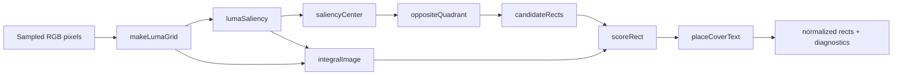

# Saliency-guided cover text placement

**Source:** `src/algorithms/layout/cover-placement.ts`

`placeCoverText(grid, blocks, options)` chooses where a cover's kicker, headline
and deck sit. It takes a small luminance grid of the surface a reader sees and
returns normalized rectangles in band coordinates. No DOM, no canvas and no
wall-clock state are involved, so the same grid always produces the same layout.

The method follows two published ideas. Visual-balance text placement computes a
saliency center of mass and prefers the quadrant opposite it. The Microsoft
visual-textual layout formulation splits the decision into intrusion into
salient pixels, wasted quiet space, and a mismatch between a block's semantic
importance and its position. Here the energy is:

```
score = wI * intrusion + wB * balance + wT * tone - wC * cornerPrior
```

`intrusion` mixes the mean and the peak saliency under a block. The peak term
matters: a small but loud focal subject is invisible to a mean taken over a
large text box. `balance` is the Manhattan distance from the block's center to
the mirror of the saliency center. `tone` is the gap to a requested backdrop
luminance, used for light cutouts on paper and dark live surfaces. `cornerPrior`
is a soft preference for the top corners; a loud subject can still override it.

## How it works



`lumaSaliency` combines local contrast (the standard deviation in a box, read
from two summed-area tables), absolute tone, and a Gaussian bias toward the
frame center. A flat cream page is quiet even though it is bright; a pixel-art
fox is loud at its edges and at its bright crest.

Blocks are placed in descending `weight` order, so the headline claims the best
quiet region first. `rectsIntersect` from the layout-rect module enforces clear
space between blocks and around reserved areas such as a breadcrumb pill.

## Complexity

| step | cost |
| --- | --- |
| `makeLumaGrid` | O(pixels) |
| `lumaSaliency` | O(cells) with two summed-area tables |
| `candidateRects` | O(blocks) candidates, constant per block |
| `placeCoverText` | O(blocks x candidates x block area) |

On a 96 x 54 grid with three blocks this is well under a millisecond.

## Pitfalls

- Sampling a transparent cutout without a backdrop color makes the cutout's
  alpha-0 pixels read as black. Pass the page's backdrop to `makeLumaGrid`.
- A fixed corner bias that is too strong will put type over the subject. Keep
  it soft and assert the result against sampled pixels.
- Mean-only intrusion loses small focal subjects. Use the peak term too.
- The returned rectangles are normalized. A host multiplies by its band's
  width and height; it must not assume pixel units.

**Contract:** `src/__tests__/layout/cover-placement.test.ts` covers integral
images, flat images, opposite-quadrant selection, reserved areas, non-overlap
and determinism.
