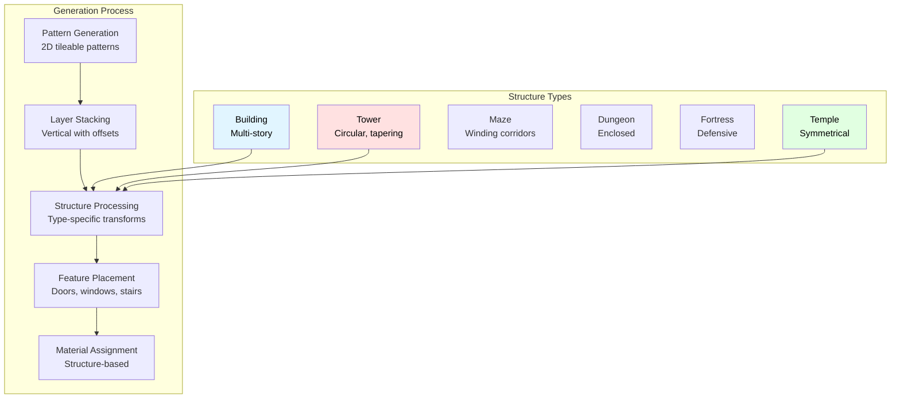

# StructureForge

Efficient layered wave function collapse for man-made structures.

## Overview

StructureForge is a procedural generation algorithm designed specifically for creating artificial, man-made structures like buildings, mazes, towers, dungeons, fortresses, and temples. Unlike traditional 3D wave function collapse algorithms that can be computationally expensive, StructureForge uses a layered 2D approach inspired by terrain generation research.

## Architecture



## Key Features

- **Efficient Generation**: Layered 2D patterns instead of expensive 3D WFC
- **Structure-Specific Optimization**: Specialized algorithms for different building types
- **Emergent Complexity**: Overlapping pattern layers create natural-looking structures
- **Real-time Performance**: Suitable for games and interactive applications
- **Configurable Materials**: Support for stone, brick, wood, metal, and crystal
- **Feature-Rich**: Doors, windows, stairs, ladders, and bridges
- **Seeded Generation**: Reproducible results with seed control

## Structure Types

### Building

Multi-story buildings with rooms, corridors, and architectural features. Good for cities and settlements.

### Tower

Tall, narrow structures like wizard towers or guard towers. Circular design with tapering height.

### Maze

Complex labyrinth structures with winding corridors. Minimal open spaces, maximum navigation challenge.

### Dungeon

Dark, enclosed underground complexes. More walls than open space, perfect for dungeon crawling.

### Fortress

Defensive structures with thick walls and strategic layouts. Combines building and tower elements.

### Temple

Symmetrical, ornate religious structures. Features complex architectural details and special materials.

## Algorithm Details

### Layered Generation Process

1. **Pattern Generation**: Creates tileable 2D patterns for corridors, rooms, structure, and features
2. **Layer Stacking**: Applies patterns vertically with controlled offsets for variation
3. **Structure Processing**: Applies type-specific transformations (circular for towers, symmetrical for temples)
4. **Feature Placement**: Adds doors, windows, stairs, and connections between layers
5. **Material Assignment**: Applies appropriate materials based on structure type and configuration

### Performance Characteristics

- **Time Complexity**: O(width × height × depth) - linear with structure size
- **Space Complexity**: O(width × height × depth) - stores complete structure
- **Memory Efficient**: Reuses pattern data, no per-cell state tracking
- **Real-time Capable**: Can generate structures in < 100ms on modern hardware

## API Reference

### StructureForge Class

```typescript
class StructureForge {
  constructor(config: StructureConfig, options?: StructureForgeOptions);
  generate(): GenerationResult;
}
```

### Configuration Types

```typescript
type StructureType = 'building' | 'tower' | 'maze' | 'dungeon' | 'fortress' | 'temple';

interface StructureConfig {
  type: StructureType;
  width: number;
  height: number;
  depth: number;
  seed?: number;
  complexity: number;
  symmetry: number;
  materialPalette: MaterialType[];
}

type MaterialType = 'stone' | 'brick' | 'wood' | 'metal' | 'crystal' | 'void';
type CellType = 'air' | 'solid' | 'door' | 'window' | 'stair_up' | 'stair_down' | 'ladder' | 'bridge';
```

### Utility Functions

```typescript
createBuildingConfig(width: number, height: number, depth: number, seed?: number): StructureConfig
createTowerConfig(radius: number, height: number, seed?: number): StructureConfig
createMazeConfig(width: number, height: number, depth: number, seed?: number): StructureConfig
createDungeonConfig(width: number, height: number, depth: number, seed?: number): StructureConfig
```

## Usage

### Quick Start

```typescript
import { StructureForge, createBuildingConfig } from '@entropy-tamer/reynard-algorithms';

const config = createBuildingConfig(16, 16, 8, 12345);
const forge = new StructureForge(config);
const result = forge.generate();

console.log(`Generated ${result.metadata.type} with ${result.layers.length} floors`);
console.log(`Generation took ${result.metadata.generationTime.toFixed(2)}ms`);
```

### Basic Building Generation

```typescript
const config = {
  type: 'building' as const,
  width: 20,
  height: 20,
  depth: 6,
  seed: 42,
  complexity: 0.7,
  symmetry: 0.5,
  materialPalette: ['stone', 'brick', 'wood']
};

const forge = new StructureForge(config);
const structure = forge.generate();

structure.layers.forEach((layer, index) => {
  console.log(`Floor ${index + 1}:`, layer.length, '×', layer[0].length);
});
```

### Tower with Custom Materials

```typescript
const config = createTowerConfig(12, 8, 999);
config.materialPalette = ['stone', 'crystal', 'metal'];

const forge = new StructureForge(config, {
  enableBridges: true,
  enableSkylights: true,
  heightVariation: true
});

const tower = forge.generate();
```

## Technical Insights

### Why Layered 2D Over 3D WFC?

Traditional 3D wave function collapse requires tracking constraints in three dimensions, leading to exponential complexity. StructureForge's layered approach:

- **Reduces Complexity**: 2D pattern generation is computationally cheaper
- **Maintains Emergence**: Overlapping layers create natural 3D structures
- **Enables Control**: Easy to apply structure-specific transformations
- **Improves Performance**: Suitable for real-time generation in games

### Emergent Properties

The algorithm creates realistic architectural features through pattern interaction:

- **Skylights**: Air pockets spanning multiple floors
- **Bridges**: Connections between adjacent structures
- **Natural Variation**: Height differences and irregular spacing
- **Architectural Details**: Emergent arches, buttresses, and structural elements