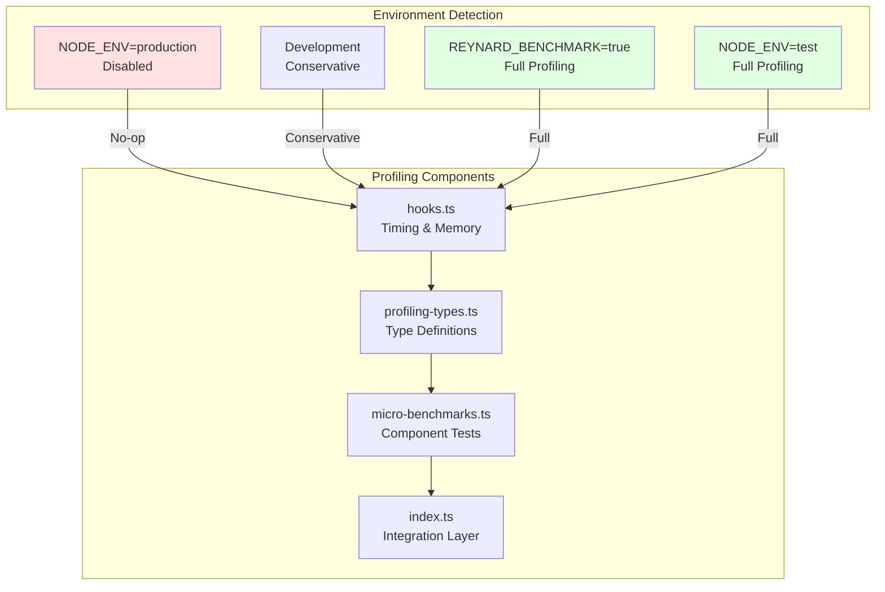

# PAW Performance Profiling

## Overview

Zero-overhead performance profiling hooks and micro-benchmarks for PAW that are completely disabled in production and only active during benchmarking and analysis.

## Architecture



## Components

### Profiling Hooks

Location: `src/optimization/profiling/hooks.ts`

Provides zero-overhead performance tracking:
- Timing measurements with start/stop pattern
- Memory snapshots and allocation tracking
- Automatic data management to prevent memory bloat
- Environment-aware activation

```typescript
import { pawPerformance } from '@entropy-tamer/reynard-algorithms';

// Manual timing
const endTiming = pawPerformance.startTiming('operation-name');
// ... perform operation
const duration = endTiming();

// Memory tracking
const memory = pawPerformance.trackMemory('component-name');
memory.snapshot();
memory.trackAllocation('array', 1024);

// Get performance report
const report = pawPerformance.getReport();
console.log('Total operations:', report.summary.totalOperations);
console.log('Average time:', report.summary.averageExecutionTime);
console.log('Peak memory:', report.summary.peakMemoryUsage);
```

### Type Definitions

Location: `src/optimization/profiling/profiling-types.ts`

Complete type safety for performance metrics:
- `MemorySnapshot`: Memory usage at a point in time
- `AllocationRecord`: Individual allocation tracking
- `TimingProfile`: Timing statistics with percentiles
- `BenchmarkResult`: Benchmark execution results
- `MicroBenchmarkConfig`: Benchmark configuration
- `ComponentBenchmark`: Component-specific benchmark

### Micro-Benchmarks

Location: `src/optimization/profiling/micro-benchmarks.ts`

Component-level benchmarks for PAW components:
- Algorithm Selection: Grid classification and performance prediction
- Memory Pooling: Allocation and cleanup performance
- Clustering: Fixed vs adaptive clustering comparisons
- High Complexity: Complexity profiling and specialized algorithms

### Integration Layer

Location: `src/optimization/profiling/index.ts`

Single entry point for all profiling functionality:
- `pawPerformance`: Main performance tracking object
- `pawBenchmarks`: Micro-benchmark runners
- `@PAWProfile`: Decorator for method-level profiling

## Environment Detection

The profiling system automatically detects the environment and adjusts behavior:

```typescript
// Production: completely disabled
if (process.env?.['NODE_ENV'] === 'production') {
  return { enabled: false, detailedTiming: false };
}

// Benchmark/Test: fully enabled
if (process.env?.['REYNARD_BENCHMARK'] === 'true') {
  return { enabled: true, detailedTiming: true };
}
```

**Environment Behavior:**
- **Production**: All profiling disabled (zero overhead)
- **Development**: Conservative profiling enabled
- **Benchmark**: Full profiling with detailed tracking
- **Test**: Complete profiling for analysis

## Usage

### Method-Level Profiling

```typescript
import { PAWProfile } from '@entropy-tamer/reynard-algorithms';

@PAWProfile('algorithm-selection', { trackMemory: true })
selectOptimalAlgorithm(workload: WorkloadCharacteristics) {
  // Implementation
}
```

### Manual Timing

```typescript
import { pawPerformance } from '@entropy-tamer/reynard-algorithms';

const endTiming = pawPerformance.startTiming('operation-name');
// ... perform operation
const duration = endTiming();
```

### Memory Tracking

```typescript
const memory = pawPerformance.trackMemory('component-name');
memory.snapshot();
memory.trackAllocation('array-name', 1024);
```

### Performance Report

```typescript
const report = pawPerformance.getReport();
console.log('Total operations:', report.summary.totalOperations);
console.log('Average time:', report.summary.averageExecutionTime);
console.log('Peak memory:', report.summary.peakMemoryUsage);
```

### Running Micro-Benchmarks

```typescript
import { runAllMicroBenchmarks } from '@entropy-tamer/reynard-algorithms';

const results = await runAllMicroBenchmarks();
console.log('Algorithm Selection:', results.algorithmSelection);
console.log('Memory Pool:', results.memoryPool);
console.log('Clustering:', results.clustering);
console.log('High Complexity:', results.highComplexity);
```

## Enabling Profiling

```bash
# Development mode
REYNARD_PROFILING=true pnpm dev

# Benchmark mode
REYNARD_BENCHMARK=true pnpm bench

# Test mode
NODE_ENV=test pnpm test
```

## Performance Impact

- **Production**: Zero overhead - all profiling disabled
- **Development**: Minimal overhead (<1% impact)
- **Benchmark**: Full profiling for analysis (not production use)
